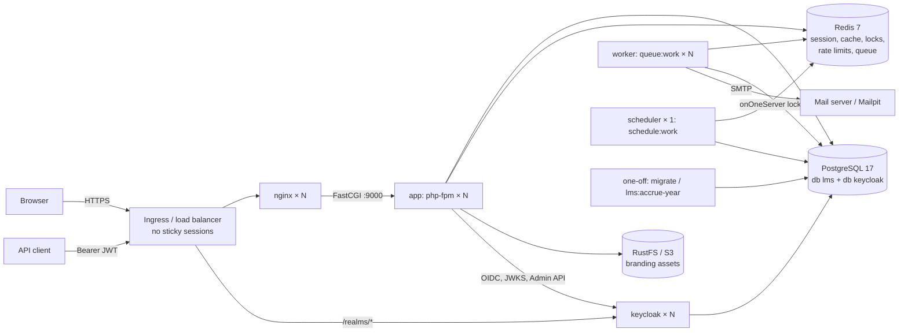
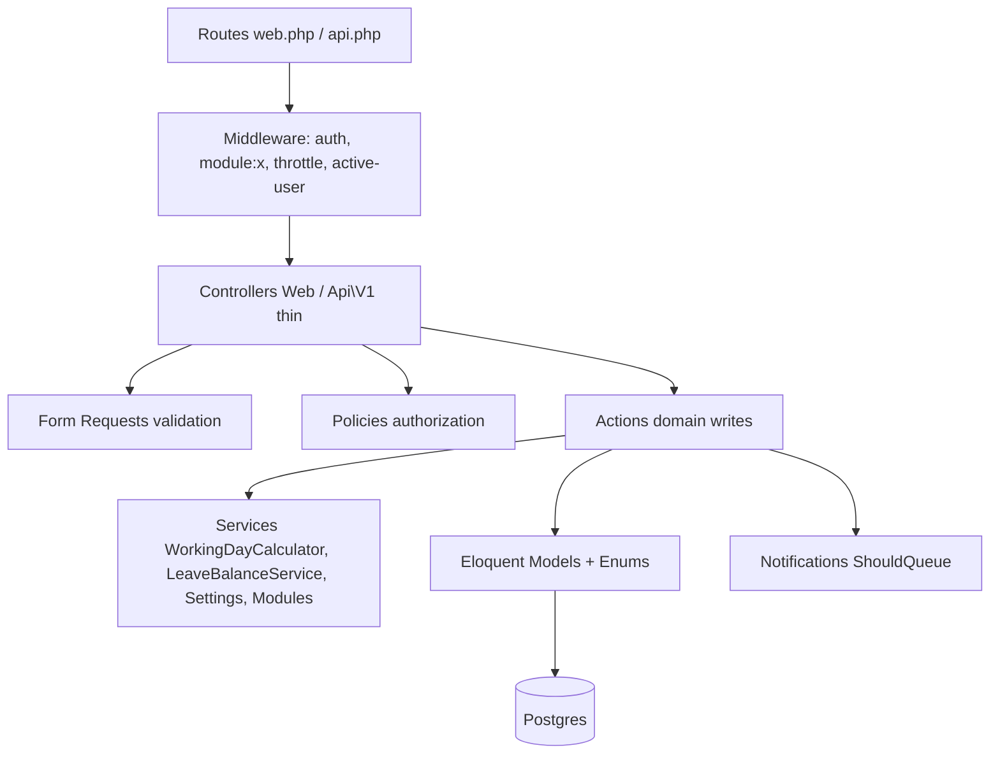
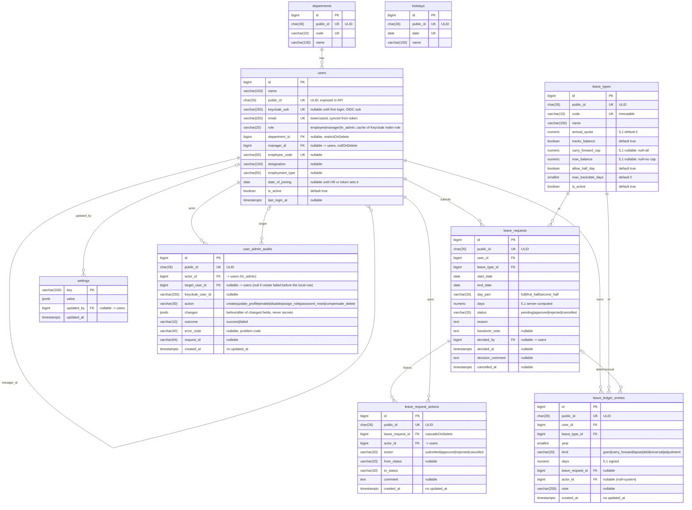

# LMS — System Design

Status: v1.2 (architect, 2026-11-19; Keycloak D-20, API contract D-21, in-app user admin D-22). Business rules live in [USE_CASES.md](USE_CASES.md). Where this file and USE_CASES disagree, USE_CASES wins for business rules and this file wins for technical design.

## 1. Context & constraints

| Item | Choice |
|---|---|
| Product | White-label, **single-tenant** LMS. One deployment (and one DB) per customer. |
| Runtime | PHP-FPM **8.4**, Laravel **12.x**, PostgreSQL **17**, NGINX (stable, alpine) |
| UI | Server-rendered Blade + one plain CSS file (`public/css/app.css`) using CSS custom properties. **No Node/Vite build** (D-05). |
| API | JSON, `/api/v1`, contract-first: [`docs/api/openapi.yaml`](api/openapi.yaml) + [`docs/API_GUIDELINES.md`](API_GUIDELINES.md) (D-21). Bearer JWT from Keycloak (D-20). |
| Identity | **Keycloak 26** (own container, `keycloak` DB on the same Postgres server, clustered in prod). Realm `lms`, realm roles `employee|manager|hr_admin`, clients `lms-web` (confidential), `lms-api-cli` (public, PKCE), `lms-admin` (service account, D-22). See §10.1 (D-20). |
| Web auth | OIDC auth code via Laravel Socialite (`socialiteproviders/keycloak`) → Laravel session (store per `SESSION_DRIVER`), CSRF. No passwords in the app. |
| Queue / cache / session / locks / rate limits | **Redis 7** (`phpredis`), D-23. Separate logical DBs: `default` 0, `cache` 1 (cache, atomic locks, rate limiters, JWKS, admin token, idempotency keys), `session` 2 (`SESSION_CONNECTION=session`), queue 3. Key prefix `REDIS_PREFIX=lms-`. `failed_jobs` stays in Postgres. |
| Mail | SMTP via env. `log` mailer in tests, Mailpit in compose. |
| Files | Laravel disk `BRANDING_DISK=s3` (and `FILESYSTEM_DISK=s3`): **RustFS** (S3-compatible) in dev/compose, any S3-compatible store in prod. The `branding` local disk exists only for single-node installs (D-24). |
| Scaling | `app`, `worker`, `nginx`, `keycloak` scale horizontally; no sticky sessions; scheduler tasks `onOneServer()`; migrations as a one-off job (D-24, §3.1). |
| Delivery | Docker images `ghcr.io/heyadityak/lms/{app,nginx}` (amd64 on `main`, amd64+arm64 on `v*` tags), 12-factor (D-25, §13) |

## 2. Architecture

Full set of diagrams (context, containers, deployment, scaling, DFD, class, sequence, activity, state): [docs/diagrams/](diagrams/README.md).



Layers inside the app:



## 3. Container topology

One Dockerfile with multi-stage targets (D-09). Same `app` image runs as web, worker, scheduler and one-off.

| Service (compose) | Image / target | Command | Ports | Prod? | Notes |
|---|---|---|---|---|---|
| `nginx` | `Dockerfile` target `nginx` | default | `8080:80` (dev) | yes | `nginx:stable-alpine`. Config from `/etc/nginx/templates/default.conf.template` (envsubst `PHP_FPM_HOST`, default `app:9000`). Copies `public/` from the build. Logs to stdout/stderr. |
| `app` | target `app-dev` (dev) / `app-prod` | `php-fpm -F` | 9000 (internal) | yes | Dev bind-mounts `./:/var/www/html`. |
| `worker` | same as app | `php artisan queue:work --tries=3 --backoff=10 --max-time=3600` | — | yes | Restart policy `unless-stopped`. SIGTERM finishes the current job. |
| `scheduler` | same as app | `php artisan schedule:work` | — | yes (1 replica; more are safe) | Every scheduled task uses `->onOneServer()->withoutOverlapping()` (Redis locks). |
| `postgres` | `postgres:17-alpine` | — | `5432:5432` (dev) | managed DB in prod | `docker/postgres/init/01-test-db.sql` creates `lms_test`. Healthcheck `pg_isready`. Named volume `pgdata`. |
| `redis` | `redis:7-alpine` | `redis-server --appendonly yes` | internal | managed Redis in prod (TLS via `REDIS_SCHEME=tls` / `REDIS_URL`) | Healthcheck `redis-cli ping`. Volume `redisdata`. |
| `rustfs` | `rustfs/rustfs` | — | `9000` S3 API, `9001` console | **dev** (prod: any S3-compatible store) | `RUSTFS_ACCESS_KEY` / `RUSTFS_SECRET_KEY`. Volume `s3data`. Healthcheck `/health`. |
| `s3-init` | `amazon/aws-cli` | `head-bucket \|\| create-bucket $AWS_BUCKET` | — | dev; prod bucket is provisioned by IaC | Init container, idempotent. `app`/`worker`/`scheduler` wait for `service_completed_successfully`. |
| `keycloak` | `quay.io/keycloak/keycloak:26.x` (dev `start-dev --import-realm`); prod image from `docker/keycloak/Dockerfile` (`start --optimized`, `KC_CACHE=ispn`) | — | `8081:8080` (dev) | yes, ≥2 replicas clustered | DB `keycloak` on the same Postgres (`docker/postgres/init` creates it). Dev realm import `docker/keycloak/realm-lms.json` (realm, roles, clients, dev users). Health on management port 9000 `/health/ready`. |
| `mailpit` | `axllent/mailpit` | — | `8025` UI, `1025` SMTP | **dev only** | Also Keycloak's SMTP in dev. |
| one-off | same as app | `docker compose run --rm app php artisan migrate --force` | — | yes | Admin processes (12-factor XII). |

Volumes (dev): `pgdata`, `redisdata`, `s3data`. No app container has local state.

### 3.1 Horizontal scaling rules (D-24)

| Rule | How |
|---|---|
| No sticky sessions | Sessions in Redis (`session` DB). Any replica serves any request. CSRF token lives in the session, so it works across replicas. |
| Shared cache, locks, rate limits | Redis `cache` DB. `Cache::lock()`, `RateLimiter`, `Settings` cache invalidation are cluster-wide. |
| Uploads | Only on the shared S3 disk (RustFS/S3). Never `storage/app` in prod. |
| Scheduler | `onOneServer()` + `withoutOverlapping()` on every scheduled task (Redis atomic locks), so running >1 scheduler is harmless. |
| Queue | Redis queue; N workers; jobs idempotent; `failed_jobs` in Postgres. |
| Migrations | One-off job per release (`php artisan migrate --force`), before rolling out new replicas. Never in the entrypoint. |
| Health | `/healthz` liveness (no I/O); `/readyz` readiness = Postgres `select 1` + Redis `PING` (not Keycloak). |
| nginx → php-fpm | `PHP_FPM_HOST` is a service name; nginx re-resolves it with `NGINX_RESOLVER` so new app replicas are picked up. |

### Dockerfile targets

| Target | FROM | Contents |
|---|---|---|
| `php-base` | `php:8.4-fpm-alpine` | ext: `pdo_pgsql`, `intl`, `opcache`, `pcntl`, `zip`, `bcmath`, `redis` (pecl phpredis). `docker/php/php.ini`, `docker/php/zz-fpm.conf` (`catch_workers_output=yes`, `decorate_workers_output=no`, `access.log=/dev/null` since nginx logs access, `clear_env=no`). Runs as `www-data`. |
| `app-dev` | `php-base` | + composer binary (`COPY --from=composer:2`), `UID`/`GID` build args. No code copied (bind mount). |
| `vendor` | `composer:2` | `composer install --no-dev --no-scripts --prefer-dist --optimize-autoloader` using `composer.json/lock` only (layer cache) |
| `app-prod` | `php-base` | Copy code + vendor. `opcache.validate_timestamps=0`. **No** `config:cache` at build (env unknown). Entrypoint runs `php artisan config:cache && php artisan route:cache && php artisan view:cache` then `exec "$@"`. No `.env` in image. |
| `nginx` | `nginx:stable-alpine` | `COPY public/ /var/www/html/public/` + template |

`.dockerignore`: `.git`, `vendor`, `node_modules`, `.env*` (but not `.env.example`), `storage/logs/*`, `storage/app/*`, `.logs`, `tests` (prod only; dev uses bind mount).

## 4. Data model

All tables use `bigIncrements id` and `timestamps()` (`timestamptz`) unless noted. Day quantities are `numeric(5,1)`, always multiples of 0.5. PHP casts them with `'float'`. Multiples of 0.5 are exact in binary floating point, so float math is safe.



### Constraints & indexes (put these in migrations)

| Table | Constraint / index |
|---|---|
| `users` | `CHECK (role IN (...))`, `CHECK (manager_id <> id)`, unique `(keycloak_sub)` (NULLs allowed), index `(department_id)`, `(manager_id)` |
| all API-exposed tables (`users`, `departments`, `leave_types`, `holidays`, `leave_requests`, `leave_request_actions`, `leave_ledger_entries`) | `public_id char(26) NOT NULL UNIQUE` (ULID, Laravel `HasUlids` with `uniqueIds() = ['public_id']`, `getRouteKeyName() = 'public_id'`). bigint `id` stays the PK/FK and is never exposed (D-21). |
| `leave_requests` | `CHECK (end_date >= start_date)`, `CHECK (days > 0)`, `CHECK (day_part = 'full' OR start_date = end_date)`, `CHECK (status IN (...))`, index `(user_id, status)`, `(status, start_date)` |
| `leave_requests` | **Overlap backstop:** `CREATE EXTENSION IF NOT EXISTS btree_gist;` then `ALTER TABLE leave_requests ADD CONSTRAINT leave_requests_no_overlap EXCLUDE USING gist (user_id WITH =, daterange(start_date, end_date, '[]') WITH &&) WHERE (status IN ('pending','approved'));` Catch SQLSTATE `23P01` → 422 overlap error. |
| `leave_ledger_entries` | index `(user_id, leave_type_id, year)`. Partial unique `(user_id, leave_type_id, year, kind) WHERE kind IN ('grant','carry_forward','lapse')`. Partial unique `(leave_request_id, kind) WHERE leave_request_id IS NOT NULL`, so each request gets at most one debit and one reversal. |
| `leave_request_actions` | index `(leave_request_id, created_at)` |
| `holidays` | unique `(date)` |

Laravel framework tables (keep the stock migrations): `sessions`, `cache`, `cache_locks`, `jobs`, `job_batches`, `failed_jobs`. **Not created** (D-20): `password_reset_tokens` (drop it from the stock users migration), `personal_access_tokens` (do not run `install:api` with Sanctum; create `routes/api.php` by hand). Keycloak keeps its own tables in the separate `keycloak` database.

### Enums (`app/Enums`, string-backed)
`Role`, `LeaveStatus`, `DayPart`, `LedgerKind`, `LeaveAction`, `Module` (`holidays`, `reports`, `api`, `notifications`, `multi_level_approval`, `delegation`). Models cast columns to these enums.

## 5. Domain components

| Class | Responsibility |
|---|---|
| `App\Services\WorkingDayCalculator` | `count(CarbonImmutable $start, CarbonImmutable $end, DayPart $part, array $weekendIsoDays, array $holidayDates): float`. A **pure function** with no DB access, so it is unit-testable. A thin wrapper `forRange()` loads holidays (only if the `holidays` module is on) and weekend config. |
| `App\Services\LeaveBalanceService` | `balance()`, `pending()`, `available()`, `summary(User, int $year)` (entitled/used/pending/available per type). |
| `App\Actions\Leave\SubmitLeaveRequest` | Validation V1–V8 (USE_CASES §3.4) inside `DB::transaction`, with `User::lockForUpdate()` on the requester row to serialise that user's submissions. |
| `App\Actions\Leave\ApproveLeaveRequest` / `RejectLeaveRequest` / `CancelLeaveRequest` | Lock the request row (`lockForUpdate`). Assert the current status, else throw `InvalidTransition` (409). Write the ledger entry + action row. Dispatch the notification `afterCommit`. |
| `App\Actions\Accrual\GrantInitialEntitlement`, `RunYearStartAccrual` | USE_CASES §3.7. |
| `App\Actions\Users\DeactivateUser` | Set inactive, delete the user's sessions, cancel pending requests. (JWTs are stateless: `KeycloakJwtGuard` refuses inactive users.) |
| `App\Actions\Users\UpdateUserAction` | HR edit. LMS fields always (department, manager with cycle check, joining date, employee code, designation, employment type; first `date_of_joining` → `GrantInitialEntitlement`). Profile fields (email, first/last name) only with `user_management` on and a non-federated user: Keycloak `PUT` first, then mirror. Audited. |
| `App\Actions\Users\CreateUserAction` | UC-U2. `KeycloakAdminClient::createUser()` (enabled, no credentials) → id → role mapping → `DB::transaction` insert `users` with `keycloak_sub` + LMS fields → `executeActionsEmail([UPDATE_PASSWORD, VERIFY_EMAIL])` after commit (link lifespan `config('keycloak.actions_email_lifespan')`, default 86400 s). Local failure ⇒ `deleteUser()` compensation + `compensate_delete` audit. |
| `App\Actions\Users\AssignRolesAction` | UC-U6. Allow-list, `UserAdminGuard` (G2–G3 under Redis lock `lock:hr-admin-guard`), add the new LMS realm role, remove the other two, mirror `users.role`. Audited. |
| `App\Actions\Users\SetUserEnabledAction` | UC-U4. Guardrails, Keycloak `enabled` flag, on disable `logoutUser()` then `DeactivateUser`; on enable local `is_active=true`. Audited. |
| `App\Actions\Users\SendPasswordResetAction` | UC-U5. Refuses federated users. `executeActionsEmail([UPDATE_PASSWORD])`. Audited. |
| `App\Services\UserAdminGuard` | G2–G5 checks (USE_CASES §3.11). Pure parts unit-tested. |
| `App\Support\Keycloak\KeycloakAdminClient` (interface) + `HttpKeycloakAdminClient` | Admin REST wrapper: `searchUsers`, `countUsers`, `getUser`, `createUser`, `updateUser`, `deleteUser`, `setEnabled`, `logoutUser`, `executeActionsEmail`, `realmRolesOf`, `addRealmRoles`, `removeRealmRoles`. Client-credentials token for `lms-admin` cached in Redis (`keycloak:admin-token`, TTL = `expires_in − 30 s`). Maps Keycloak 409 → `IdpConflict`, connect error/timeout/5xx → `IdpUnavailable`, federation refusal → `IdpReadOnly`. Bound in a service provider; tests bind `FakeKeycloakAdminClient`. |
| `App\Models\UserAdminAudit` | Append-only like the ledger (`update`/`delete` throw). |
| `App\Auth\KeycloakUserProvisioner` | `provision(array $claims): User`. Find by `keycloak_sub`, else link by verified email, else create. Sync `name`, `email`, `role` (`Role::fromKeycloakRoles(realm_access.roles)`, highest wins; none → `AuthorizationException`). Grants initial entitlement when a `date_of_joining` claim first appears. Used by web callback and API guard. |
| `App\Auth\KeycloakJwtGuard` | Custom guard `keycloak-jwt` (`Auth::extend`). Reads `Authorization: Bearer`, verifies RS256 signature with `JwksCache`, checks `iss` = `{KEYCLOAK_PUBLIC_URL}/realms/{realm}`, `aud`/`azp` in `KEYCLOAK_ALLOWED_AUDIENCES`, `exp`/`nbf` (`KEYCLOAK_JWT_LEEWAY`), then `KeycloakUserProvisioner` and `is_active`. Any failure → 401 problem+json. Uses `firebase/php-jwt`. |
| `App\Auth\JwksCache` | Fetches `{KEYCLOAK_BASE_URL}/realms/{realm}/protocol/openid-connect/certs` and caches it (`Cache::remember('keycloak:jwks', KEYCLOAK_JWKS_CACHE_TTL)` in Redis). On unknown `kid`, refetches once (key rotation), guarded by a Redis lock to avoid stampedes. |
| `App\Http\Controllers\Web\Auth\KeycloakLoginController` | `redirect()` (Socialite → Keycloak, `state` + PKCE), `callback()` (code exchange, verify ID/access token, provision, `Auth::login`, `session()->regenerate()`, store `id_token` in session), `logout()` (invalidate session, redirect to end-session endpoint with `id_token_hint` + `post_logout_redirect_uri=APP_URL`). |
| `App\Support\Settings` (singleton) | Key/value read with env fallback. Cached (§8). |
| `App\Support\Modules` (singleton) | `enabled(Module $m): bool`, `all()` for the admin UI. |
| `App\Notifications\*` | `LeaveRequestSubmitted`, `LeaveRequestDecided`, `LeaveRequestCancelled` (no `AccountCreated`: Keycloak owns account mails, D-20). All `ShouldQueue`, mail channel. Sent only if `notifications` is enabled. |
| `App\Console\Commands\AccrueYear` | `lms:accrue-year {year?}` → `RunYearStartAccrual`. Scheduled `yearlyOn(config('lms.leave_year_start_month'), 1, '00:10')->onOneServer()->withoutOverlapping()` (D-24, D-26). |

## 6. HTTP surface

### 6.1 Web routes (Blade, `web` middleware, session auth)

| Method | Path | Name | Who | Module |
|---|---|---|---|---|
| GET | `/login` | `login` | guest. Redirects to Keycloak (auth code + PKCE, `state`) | core |
| GET | `/auth/callback` | `auth.callback` | guest (throttle `login`). Code exchange + provisioning | core |
| POST | `/logout` | `logout` | auth. RP-initiated logout at Keycloak | core |
| GET | `/` | `dashboard` | auth | core |
| GET | `/leave-requests` | `leave-requests.index` | own | core |
| GET/POST | `/leave-requests/create`, `/leave-requests` | `.create/.store` | auth | core |
| GET | `/leave-requests/{leaveRequest}` | `.show` | policy `view` | core |
| POST | `/leave-requests/{leaveRequest}/cancel` | `.cancel` | policy `cancel` | core |
| GET | `/approvals` | `approvals.index` | manager, hr_admin | core |
| POST | `/leave-requests/{leaveRequest}/approve` / `/reject` | `.approve/.reject` | policy `decide` | core |
| GET | `/team` | `team.index` | manager (reports' balances & requests) | core |
| GET | `/holidays` | `holidays.index` | auth | `holidays` |
| resource | `/admin/holidays` | `admin.holidays.*` | hr_admin | `holidays` |
| resource | `/admin/users` (index, show, edit, update of LMS fields) + POST `/admin/users/{user}/deactivate`, `/activate` | `admin.users.*` | hr_admin | core |
| GET/POST | `/admin/users/create`, `/admin/users` (store) + PUT `/admin/users/{user}/roles`, POST `/admin/users/{user}/enable`, `/disable`, `/password-reset` (Keycloak-backed, D-22) | `admin.users.create/.store/.roles/.enable/.disable/.password-reset` | hr_admin | `user_management` |
| POST | `/admin/users/{user}/adjustments` | `admin.adjustments.store` | hr_admin | core |
| resource | `/admin/departments` | `admin.departments.*` | hr_admin | core |
| resource | `/admin/leave-types` (no destroy) | `admin.leave-types.*` | hr_admin | core |
| GET | `/admin/reports/requests` (`?format=csv`) | `admin.reports.requests` | hr_admin | `reports` |
| GET | `/admin/reports/balances` (`?format=csv`) | `admin.reports.balances` | hr_admin | `reports` |
| GET/PUT | `/admin/settings/branding` (multipart) + DELETE `/admin/settings/branding/{asset}` | `admin.branding.*` | hr_admin | core |
| GET/PUT | `/admin/settings/modules` | `admin.modules.*` | hr_admin | core |
| GET | `/branding/{asset}` (`logo`\|`favicon`) | `branding.asset` | public | core |
| GET | `/healthz`, `/readyz` | — | public, no session | core |

### 6.2 API (`/api/v1`)

**Contract-first (D-21).** The source of truth is [`docs/api/openapi.yaml`](api/openapi.yaml) (OpenAPI 3.1); conventions are in [`docs/API_GUIDELINES.md`](API_GUIDELINES.md). Routes, Resources and error codes must match the spec; QA validates every API feature-test response against it. Docs UI: `/api/docs` (only when the `api` module is on).

Middleware on every `/api/v1` route: `module:api` (404 when off) → `auth:keycloak-jwt` (401) → `active` → `throttle:api` (Redis, `X-RateLimit-*`, `Retry-After`); `POST /leave-requests` and `POST /admin/users` add `idempotent` (`EnsureIdempotency`, Redis 24 h). Errors are rendered as `application/problem+json` by the exception handler for `api/*` (API_GUIDELINES §4). `/api/docs` serves Swagger UI / Redoc for `docs/api/openapi.yaml` behind `module:api` (no auth; the spec holds no secrets). Envelope `{data, meta, links}`, snake_case, ULID `id`s (the `public_id` column), RFC 9457 `application/problem+json` errors with a stable `code`.

| Area | Endpoints (all under `/api/v1`) | Roles (`x-roles`) |
|---|---|---|
| Me | `GET /me`, `GET /me/balances`, `GET /me/leave-requests`, `GET /me/ledger-entries` | any |
| Leave types | `GET /leave-types`, `GET /leave-types/{id}`; `POST`, `PATCH /leave-types/{id}` | read any; write hr_admin |
| Holidays (`holidays` module) | `GET /holidays`, `GET /holidays/{id}`; `POST`, `PATCH`, `DELETE /holidays/{id}` | read any; write hr_admin |
| Leave requests | `GET /leave-requests` (visible to caller), `POST /leave-requests` (`Idempotency-Key`), `GET /leave-requests/{id}`, `POST /leave-requests/{id}/approve`, `/reject`, `/cancel` | policy `view/create/decide/cancel` |
| Approvals | `GET /approvals?filter[status]=pending` | manager, hr_admin |
| Balances / ledger | `GET /users/{id}/balances`, `GET /users/{id}/ledger-entries`, `POST /users/{id}/ledger-entries` (adjustment) | self/manager-of/hr_admin; write hr_admin |
| Users (LMS fields) | `GET /users`, `GET /users/{id}`, `PATCH /users/{id}` (department, manager, joining date, codes; role read-only here), `POST /users/{id}/deactivate`, `/activate` | hr_admin (manager: own reports, read) |
| Identity admin (`user_management` module, D-22) | `GET/POST /admin/users` (`Idempotency-Key` on POST), `GET/PATCH /admin/users/{id}`, `POST /admin/users/{id}/enable`, `/disable`, `PUT /admin/users/{id}/roles`, `POST /admin/users/{id}/password-reset` | hr_admin |
| Departments | `GET/POST /departments`, `GET/PATCH/DELETE /departments/{id}` | read any; write hr_admin |
| Settings | `GET/PATCH /settings/branding`, `DELETE /settings/branding` (reset), `PUT/DELETE /settings/branding/assets/{asset}`, `GET /modules`, `PATCH /modules/{key}` | hr_admin (branding GET: any) |
| Reports (`reports` module) | `GET /reports/leave-requests`, `GET /reports/balances` (`Accept: application/json` or `text/csv`) | hr_admin |
| Health (outside v1, no auth) | `GET /healthz`, `GET /readyz` | public |

Tokens are obtained from Keycloak (client `lms-api-cli`, auth code + PKCE), never from the app. There are no `/tokens` endpoints.

## 7. State machine
See USE_CASES §3.6 (diagram + transition/actor table). Implementation: `LeaveStatus::canTransitionTo(LeaveStatus $to): bool` holds the allowed edges. Actions call it. Policies decide **who**. The enum decides **whether**.

## 8. White-label: settings, theming, modules

### 8.1 Settings resolution
`effective(key) = settings.value (DB override) ?? config default (from env)`. Read via `App\Support\Settings::get(key)`. Cached with `Cache::rememberForever('settings:all', …)` (Redis cache store) and invalidated on every write. Per-request memoised. There is no cross-replica staleness beyond one request because every replica reads the same Redis cache.

| Setting key | Env default | Validation | Used in |
|---|---|---|---|
| `brand.name` | `APP_BRAND_NAME` (default `"Leave Manager"`) | string 1–60 | `<title>`, header, mail `from.name`, mail subjects |
| `brand.primary_color` | `BRAND_PRIMARY_COLOR` (default `#1f6feb`) | regex `^#[0-9a-fA-F]{6}$` | `--brand-primary` |
| `brand.accent_color` | `BRAND_ACCENT_COLOR` (default `#0e8a16`) | same | `--brand-accent` |
| `brand.logo_path` | none → `public/img/default-logo.png` | upload: `mimes:png,jpg,jpeg,webp`, `max:1024` KB, `dimensions:max_width=1024,max_height=1024` | header, emails (absolute URL) |
| `brand.favicon_path` | none → `public/favicon.ico` | `mimes:png,ico`, `max:256` | `<link rel=icon>` |
| `modules.disabled` | `[]` | array of `Module` values ⊆ licensed | `Modules` |

`config/branding.php` holds the env defaults plus `disk => env('BRANDING_DISK', 's3')`. The `s3` disk (private bucket `AWS_BUCKET`) is configured by the standard `AWS_*` env vars (+ `AWS_ENDPOINT`, `AWS_USE_PATH_STYLE_ENDPOINT=true` for RustFS; any S3-compatible store in prod). In dev the bucket is created by the `s3-init` container. `config/filesystems.php` also keeps a `branding` local disk (`storage_path('app/branding')`) for single-node installs only; it breaks with >1 replica (D-24). Composer dep: `league/flysystem-aws-s3-v3`.

### 8.2 Theming
- `public/css/app.css` uses only variables: `var(--brand-primary)`, `var(--brand-accent)`, plus derived ones (`--brand-primary-contrast` computed in PHP: black or white by luminance).
- `resources/views/layouts/app.blade.php` emits `<style>:root{--brand-primary:{{ $primary }};--brand-accent:{{ $accent }};--brand-primary-contrast:{{ $contrast }};}</style>`. Values are regex-validated hex on write and re-validated on read (fallback to default), so no CSS injection.
- A view composer (`BrandingComposer`) shares a `$brand` object (name, colors, logoUrl, faviconUrl) with all views.
- Assets are served by `GET /branding/{asset}` → `Storage::disk(config('branding.disk'))->response($path)` with `Cache-Control: public, max-age=300` and ETag. Uploaded file names are `logo-{sha1}.{ext}`, so the URL changes on upload and caching is safe. This works the same for local and S3 disks. Nothing is baked into the image.
- SVG uploads are **rejected** (stored-XSS risk).

### 8.3 Module registry `config/modules.php`

```php
return [
    'licensed' => array_filter(array_map('trim', explode(',', env('MODULES_ENABLED', 'holidays,reports,api,notifications,user_management')))),
    'registry' => [
        'holidays'             => ['label' => 'Holiday calendar',     'available' => true],
        'reports'              => ['label' => 'Reports & exports',    'available' => true],
        'api'                  => ['label' => 'REST API',             'available' => true],
        'notifications'        => ['label' => 'Email notifications',  'available' => true],
        'multi_level_approval' => ['label' => 'Multi-level approval', 'available' => false], // Later
        'delegation'           => ['label' => 'Approval delegation',  'available' => false], // Later
        'user_management'      => ['label' => 'User management (Keycloak)', 'available' => true], // D-22
    ],
];
```

`Modules::enabled($m) = in_array($m, licensed) && registry[$m].available && !in_array($m, Settings::get('modules.disabled'))`.

Gating points (all four are required):

| Layer | Mechanism |
|---|---|
| Routes | Middleware alias `module` (`EnsureModuleEnabled`): `Route::middleware('module:reports')->group(...)`. Calls `abort(404)` when off. |
| Views | Blade directive registered in `AppServiceProvider`: `Blade::if('module', fn (string $m) => app(Modules::class)->enabled(Module::from($m)));` → `@module('reports') ... @endmodule` |
| Domain | `WorkingDayCalculator::forRange` checks `holidays`. Notification dispatch checks `notifications`. |
| Admin UI | `/admin/settings/modules` lists the registry. Unlicensed/unavailable modules are disabled checkboxes. PUT accepts only licensed+available keys (422 otherwise). |

## 9. 12-factor mapping

| # | Factor | Implementation |
|---|---|---|
| I | Codebase | One repo, many deploys (one per customer). Images tagged by git SHA/semver. |
| II | Dependencies | `composer.lock` committed. PHP extensions declared in Dockerfile. No reliance on host tools (host has no PHP). |
| III | Config | Everything via env (`.env` only in dev, never in image). `.env.example` lists every key. Branding defaults + licensed modules via env. Admin overrides in DB are *data*, not config. |
| IV | Backing services | Postgres, Redis, SMTP, S3 (RustFS), Keycloak by URL/env (`DB_*`, `REDIS_*`, `MAIL_*`, `AWS_*`, `KEYCLOAK_*`). Swap without code change. |
| V | Build, release, run | CI builds an immutable image. Release = image + env. Caches (`config:cache` etc.) are built at container start. |
| VI | Processes | Stateless: sessions/cache/locks/queue in Redis, uploads on the shared S3 disk. No local state in prod containers, no sticky sessions. |
| VII | Port binding | php-fpm on 9000, nginx on 80. |
| VIII | Concurrency | Scale `nginx`, `app`, `worker`, `keycloak` horizontally. `scheduler` = 1 replica, tasks `onOneServer()` + `withoutOverlapping()` (Redis locks). See §3.1. |
| IX | Disposability | Fast start. `queue:work` handles SIGTERM gracefully. php-fpm graceful on SIGQUIT (`STOPSIGNAL SIGQUIT`). |
| X | Dev/prod parity | Same Dockerfile, same Postgres (17) and Redis (7) majors, same drivers, S3 API in dev too (RustFS). Only Mailpit and the Keycloak start mode (`start-dev` + realm import) differ. |
| XI | Logs | `LOG_CHANNEL=stderr`, `LOG_STDERR_FORMATTER=Monolog\Formatter\JsonFormatter`. nginx access/error → stdout/stderr. No log files. |
| XII | Admin processes | `docker compose run --rm app php artisan migrate --force`, `... lms:accrue-year 2027`, `... db:seed --class=DemoSeeder`. In prod: same image as a one-off job. |

### Environment variables (`.env.example` must contain all)

| Var | Dev default | Notes |
|---|---|---|
| `APP_NAME`, `APP_ENV`, `APP_KEY`, `APP_DEBUG`, `APP_URL` | `LMS`, `local`, (generate), `true`, `http://localhost:8080` | |
| `APP_TIMEZONE` | `UTC` | wire into `config/app.php` |
| `LOG_CHANNEL`, `LOG_STDERR_FORMATTER`, `LOG_LEVEL` | `stderr`, `Monolog\Formatter\JsonFormatter`, `debug` | |
| `DB_CONNECTION`, `DB_HOST`, `DB_PORT`, `DB_DATABASE`, `DB_USERNAME`, `DB_PASSWORD` | `pgsql`, `postgres`, `5432`, `lms`, `lms`, `secret` | |
| `SESSION_DRIVER`, `SESSION_CONNECTION`, `CACHE_STORE`, `QUEUE_CONNECTION` | `redis`, `session`, `redis`, `redis` | D-23 |
| `REDIS_CLIENT`, `REDIS_URL`, `REDIS_SCHEME`, `REDIS_HOST`, `REDIS_PORT`, `REDIS_USERNAME`, `REDIS_PASSWORD` | `phpredis`, empty, `tcp`, `redis`, `6379`, empty, `null` | managed/TLS Redis: `REDIS_SCHEME=tls` or `REDIS_URL=tls://…` |
| `REDIS_DB`, `REDIS_CACHE_DB`, `REDIS_SESSION_DB`, `REDIS_QUEUE_DB`, `REDIS_PREFIX` | `0`, `1`, `2`, `3`, `lms-` | separate logical DBs so `cache:clear` never drops sessions or jobs |
| `SESSION_SECURE_COOKIE` | `false` (prod `true`) | |
| `MAIL_MAILER`, `MAIL_HOST`, `MAIL_PORT`, `MAIL_FROM_ADDRESS` | `smtp`, `mailpit`, `1025`, `noreply@example.test` | from-name = brand name |
| `LMS_WEEKEND_DAYS` | `6,7` | ISO weekdays |
| `LEAVE_YEAR_START_MONTH` | `1` | 1–12, first month of the leave year (D-26). `4` = April–March. |
| `LMS_SL_MAX_BACKDATE_DAYS` | `7` | seed default for SL `max_backdate_days` |
| `APP_BRAND_NAME`, `BRAND_PRIMARY_COLOR`, `BRAND_ACCENT_COLOR` | `Leave Manager`, `#1f6feb`, `#0e8a16` | |
| `MODULES_ENABLED` | `holidays,reports,api,notifications,user_management` | licensed set |
| `FILESYSTEM_DISK`, `BRANDING_DISK` | `s3`, `s3` | `branding` (local) only for single-node installs |
| `RUSTFS_ACCESS_KEY`, `RUSTFS_SECRET_KEY` | `lmsdev`, `lmsdevsecret` | dev RustFS server credentials (compose only) |
| `AWS_ACCESS_KEY_ID`, `AWS_SECRET_ACCESS_KEY`, `AWS_DEFAULT_REGION`, `AWS_BUCKET`, `AWS_ENDPOINT`, `AWS_USE_PATH_STYLE_ENDPOINT` | `${RUSTFS_ACCESS_KEY}`, `${RUSTFS_SECRET_KEY}`, `us-east-1`, `lms`, `http://rustfs:9000`, `true` | any S3-compatible store in prod |
| `KEYCLOAK_BASE_URL` | `http://keycloak:8080` | **back-channel** URL used by app/worker (token exchange, userinfo, JWKS, Admin API) |
| `KEYCLOAK_PUBLIC_URL` | `http://localhost:8081` | browser redirects and token issuer: expected `iss` = `{KEYCLOAK_PUBLIC_URL}/realms/{KEYCLOAK_REALM}` |
| `KEYCLOAK_REALM` | `lms` | |
| `KEYCLOAK_CLIENT_ID`, `KEYCLOAK_CLIENT_SECRET` | `lms-web`, `lms-web-dev-secret` | confidential web client. **Secret**: regenerate per deployment. |
| `KEYCLOAK_REDIRECT_URI` | `http://localhost:8080/auth/callback` | `${APP_URL}/auth/callback` |
| `KEYCLOAK_ALLOWED_AUDIENCES` | `lms-web,lms-api-cli` | a JWT is accepted only if its `aud` (or `azp`) is in this list |
| `KEYCLOAK_JWT_LEEWAY` | `30` | seconds of clock skew for `exp`/`nbf`/`iat` |
| `KEYCLOAK_JWKS_CACHE_TTL` | `3600` | seconds, Redis |
| `KEYCLOAK_ADMIN_CLIENT_ID`, `KEYCLOAK_ADMIN_CLIENT_SECRET` | `lms-admin`, `lms-admin-dev-secret` | service-account client for the Admin REST API (D-22). **Secret**. |
| `KEYCLOAK_ADMIN`, `KEYCLOAK_ADMIN_PASSWORD` | `admin`, `admin` | compose only: Keycloak bootstrap admin (`KC_BOOTSTRAP_ADMIN_*`) |
| Keycloak container | — | `KC_DB=postgres`, `KC_DB_URL=jdbc:postgresql://postgres:5432/keycloak`, `KC_DB_USERNAME`, `KC_DB_PASSWORD`, `KC_HOSTNAME=${KEYCLOAK_PUBLIC_URL}`, `KC_HOSTNAME_BACKCHANNEL_DYNAMIC=true`, `KC_HTTP_ENABLED=true` (dev), `KC_HEALTH_ENABLED=true`; prod image adds `KC_CACHE=ispn` (clustered) |
| `PHP_FPM_HOST` | `app:9000` | nginx template |
| `NGINX_RESOLVER` | `127.0.0.11` | DNS nginx uses to re-resolve `PHP_FPM_HOST` (k8s: kube-dns IP) |
| `TRUSTED_PROXIES` | `*` (dev) | behind ingress |

## 10. Security

| Concern | Control |
|---|---|
| AuthN web | Keycloak OIDC auth code (client `lms-web`, `state` + PKCE) via Socialite. ID/access token verified (`JwksCache`), user provisioned/synced (`KeycloakUserProvisioner`), Laravel session guard, session regenerated on login. `is_active` checked at callback and by `EnsureUserIsActive` on every request. Logout is RP-initiated (end-session with `id_token_hint`). Passwords, MFA, lockout and brute-force detection live in Keycloak. |
| AuthN API | Bearer JWT (RS256) from Keycloak (client `lms-api-cli`, public + PKCE). Guard `keycloak-jwt` checks signature (JWKS cached in Redis, refetch on unknown `kid`), `iss`, `aud`/`azp` against `KEYCLOAK_ALLOWED_AUDIENCES`, `exp`/`nbf` with `KEYCLOAK_JWT_LEEWAY`. No app-issued tokens. Inactive user → 401. |
| Roles | Keycloak realm roles are the RBAC authority; `users.role` is a cache refreshed on every login/API call. HR cannot change roles in the app (D-20). |
| AuthZ | Role enum + **Policies** (`LeaveRequestPolicy`: `view, create, cancel, decide`; `UserPolicy`, `LeaveTypePolicy`, `HolidayPolicy`, `DepartmentPolicy`, `SettingsPolicy` → `hr_admin`). `Gate::before` is **not** used (HR must not approve their own requests). Every controller method calls `$this->authorize()` / `Gate::authorize()`. |
| CSRF | Default `web` middleware (`VerifyCsrfToken`/`ValidateCsrfToken`). API uses Bearer tokens only (no cookie-auth SPA). OIDC `state` protects the callback. |
| Rate limiting | `RateLimiter::for('login', 10/min by IP)` on `/auth/callback`, `RateLimiter::for('api', 60/min by user id or IP)` with `X-RateLimit-*` / `Retry-After` headers (D-21). Credential brute-force protection is Keycloak's. |
| Input | Form Requests on every write. Eloquent bindings only (no raw string SQL with input). Mass assignment via `$fillable`. |
| Output | Blade `{{ }}` escaping. No `{!! !!}` except the CSS variable block, which holds validated hex. |
| Uploads | Mime + size + dimension validation. No SVG. Random hashed names. Private disk served via controller. |
| Headers | nginx: `X-Content-Type-Options nosniff`, `X-Frame-Options DENY`, `Referrer-Policy strict-origin-when-cross-origin`, `server_tokens off`. HSTS at ingress. |
| Data | No hard deletes of users or requests. Ledger append-only (model `update()`/`delete()` throw). |
| Secrets | Only via env / orchestrator secrets. Never committed, never in the image. |

### 10.1 Identity (Keycloak, D-20)

| Item | Spec |
|---|---|
| Realm | `lms` per deployment. Realm roles `employee`, `manager`, `hr_admin` (default role for new users: `employee`). |
| Clients | `lms-web`: confidential, standard flow only, redirect `${APP_URL}/auth/callback`, post-logout redirect `${APP_URL}/*`. `lms-api-cli`: public, standard flow + PKCE S256, loopback redirect URIs. `lms-dev-cli` (**dev realm import only**): direct access grants for local smoke tests, never imported in prod. Both: realm roles in `realm_access.roles`. `lms-admin`: confidential, **service account only** (client credentials, no browser flows), service-account roles `realm-management`: `manage-users`, `view-users`, `query-users` — never `realm-admin` (D-22). |
| Claims used | `sub` → `users.keycloak_sub`, `email`, `email_verified`, `name`, `realm_access.roles`, optional `date_of_joining` (user-attribute mapper). |
| Enterprise | User federation (LDAP / Active Directory), identity brokering (SAML 2.0, OIDC e.g. Entra ID / Azure AD, Google), MFA/OTP/WebAuthn, password policy — all configured in Keycloak per customer, no app change. Login theme white-labelled per customer (UC-B9). |
| Resource authorization | Laravel Policies (direct manager approves, nobody approves own, HR override rules). Keycloak roles only say *what kind of user*. |
| Availability | Prod: ≥2 Keycloak replicas, clustered (Infinispan, `KC_CACHE=ispn`), DB `keycloak` on the managed Postgres. The app only needs Keycloak at login and for JWKS refresh; JWT validation works from the Redis-cached JWKS during short Keycloak outages. |
| Health | `/readyz` does **not** call Keycloak (avoids cascading restarts); Keycloak exposes its own `/health/ready` (`KC_HEALTH_ENABLED`). |

## 11. Observability

| Item | Spec |
|---|---|
| Logs | JSON lines to stderr (Monolog `JsonFormatter`). Add context via `Log::withContext(['request_id' => …, 'user_id' => …])` in middleware. `X-Request-Id` comes from nginx `$request_id` (forwarded as `fastcgi_param HTTP_X_REQUEST_ID`) and is echoed in the response header. |
| Domain events | `Log::info('leave.approved', [...ids, days])` for each transition, accrual run summary, settings change. |
| `GET /healthz` | Liveness. No DB. `200 {"status":"ok"}`. Excluded from session/CSRF middleware (register outside the `web` group or via `withoutMiddleware`). |
| `GET /readyz` | Readiness. `DB::select('select 1')` + `Schema::hasTable('migrations')` and Redis `PING` → `200 {"status":"ready","checks":{"db":"ok","redis":"ok"}}`, else `503 {"status":"unavailable","checks":{…"fail"}}`. Does **not** check Keycloak, S3 or SMTP (a dependency blip must not restart every replica). No secrets in output. |
| nginx | `location = /nginx-health { return 200; }` for the nginx container's own healthcheck. |
| Queue | Redis queue; `failed_jobs` table in Postgres. `php artisan queue:failed` as a one-off. |
| Keycloak | `/health/ready`, `/metrics` on the management port (9000). |
| Compose healthchecks | postgres `pg_isready`, redis `redis-cli ping`, rustfs `/health`, keycloak `/health/ready`, nginx `/nginx-health`; `s3-init` must complete before app/worker/scheduler start. app: `php-fpm-healthcheck` not required; use `SCRIPT_NAME=/ping` fpm ping (`ping.path=/ping`) via `cgi-fcgi`. Optional, platform's call. |

## 12. Migrations strategy

- Migrations are **forward-only in prod**. Write `down()` for dev convenience, but never rely on it.
- Run as a one-off **before** rolling out new app containers: `docker compose run --rm app php artisan migrate --force`. Never auto-migrate in the web entrypoint (avoids races with N replicas).
- Expand/contract for breaking changes: add nullable column → deploy code writing both → backfill (one-off command) → enforce NOT NULL / drop old in a later release.
- Postgres-specific DDL (`btree_gist`, exclusion constraint, partial unique indexes, CHECKs) via `DB::statement()` inside migrations. Feature tests run on real Postgres, so these are tested.
- Seeders: `LeaveTypeSeeder` (CL/SL/EL/LWP, idempotent `updateOrCreate` by code) runs in all envs. `DemoSeeder` runs **only** when `APP_ENV=local|testing`: departments CE/IT/MH/EC/IC/CL/CH from the original, 2026+2027 holidays, and the three **dev users** that also exist in the dev Keycloak realm import (`docker/keycloak/realm-lms.json`): `alice` (`alice@example.test`, employee, IT, manager = bob), `bob` (`bob@example.test`, manager, IT), `carol` (`carol@example.test`, hr_admin, HR). Local rows are seeded with `keycloak_sub = null` and are linked by verified email on first login (USE_CASES §3.10). Passwords exist only in Keycloak (dev value documented in the realm file, DEV ONLY). No other demo users are seeded, because users without a Keycloak account cannot log in.
- Migration file order: departments → users (alter stock: drop `password`, `remember_token`, `email_verified_at`, `password_reset_tokens`; add `public_id`, `keycloak_sub`, LMS columns) → leave_types → holidays → leave_requests → leave_request_actions → leave_ledger_entries → settings → user_admin_audits.
- Keycloak's schema lives in the separate `keycloak` database and is migrated by Keycloak itself on start.

## 13. CI/CD (GitHub Actions)

Single workflow `.github/workflows/ci.yml`, triggers: `pull_request`, `push` to `main`, tags `v*` (D-25).

| Job | Runs on | Steps | Needs |
|---|---|---|---|
| `lint` | ubuntu-latest | `shivammathur/setup-php@v2` (php 8.4, ext `pdo_pgsql,intl,bcmath,zip,redis`), composer cache, `composer install`, `vendor/bin/pint --test` | — |
| `openapi` | ubuntu-latest | `docker run --rm -v "$PWD":/work redocly/cli lint /work/docs/api/openapi.yaml` (fails on errors; the 2 documented warnings on `/healthz` `/readyz` are accepted) | — |
| `unit` | ubuntu-latest | same PHP setup, `cp .env.example .env && php artisan key:generate`, `php artisan test --testsuite=Unit` | — |
| `feature` | ubuntu-latest + services `postgres:17` (`POSTGRES_DB=lms_test`, `POSTGRES_USER=lms`, `POSTGRES_PASSWORD=secret`, healthcheck `pg_isready`, port 5432) and `redis:7` (healthcheck `redis-cli ping`, port 6379) | same setup, env `DB_HOST=127.0.0.1 DB_DATABASE=lms_test REDIS_HOST=127.0.0.1`, `php artisan test --testsuite=Feature`. API tests validate responses against `docs/api/openapi.yaml`. No Keycloak: tests sign JWTs with a test key and fake `JwksCache` / `KeycloakAdminClient`. | — |
| `smoke` | ubuntu-latest | `cp .env.example .env`, `docker compose up -d --build --wait` (all healthchecks incl. keycloak, rustfs, s3-init), `docker compose run --rm app php artisan key:generate && … migrate --force --seed`, `curl -fsS localhost:8080/healthz`, `curl -fsS localhost:8080/readyz`, `curl -fsS localhost:8081/realms/lms/.well-known/openid-configuration`, then `docker compose down -v`. Dumps `docker compose logs` on failure. | `lint, unit, feature` |
| `package` | ubuntu-latest, `permissions: {contents: read, packages: write}`, `if: github.event_name == 'push'` | `docker/setup-qemu-action` (tags only), `docker/setup-buildx-action`, `docker/login-action` (ghcr.io, `${{ github.actor }}`, `GITHUB_TOKEN`), `docker/metadata-action` (tags `type=ref,event=branch`, `type=semver,pattern={{version}}`, `type=sha`), `docker/build-push-action` ×2 (`target: app-prod` → `ghcr.io/${{ github.repository }}/app`, `target: nginx` → `ghcr.io/${{ github.repository }}/nginx`). **Platforms:** `linux/amd64` on `main`; `linux/amd64,linux/arm64` on `v*` tags. `cache-from/to: type=gha`. | `lint, openapi, unit, feature, smoke` |

Image names are derived from `github.repository` and lowercased (`${GITHUB_REPOSITORY,,}`), which gives `ghcr.io/heyadityak/lms/app` and `ghcr.io/heyadityak/lms/nginx` for the `heyadityak/lms` repository. The test jobs use setup-php instead of the image for speed; the image itself is validated by `smoke` and `package`, and parity is kept on PHP 8.4, Postgres 17 and Redis 7 (D-10, D-25). The prod Keycloak image (`docker/keycloak/Dockerfile`) is built per deployment from the upstream image and is not published by this workflow in MVP.

## 14. Sources
- Laravel 12 release notes (PHP 8.2–8.5 support): https://laravel.com/docs/12.x/releases
- Laravel deployment/optimisation, queues, scheduling, Sanctum, filesystem, logging: https://laravel.com/docs/12.x/deployment , https://laravel.com/docs/12.x/queues , https://laravel.com/docs/12.x/scheduling , https://laravel.com/docs/12.x/sanctum , https://laravel.com/docs/12.x/filesystem , https://laravel.com/docs/12.x/logging
- Twelve-Factor App: https://12factor.net/
- Laravel Redis / cache locks / scheduling `onOneServer`: https://laravel.com/docs/12.x/redis , https://laravel.com/docs/12.x/cache#atomic-locks , https://laravel.com/docs/12.x/scheduling#running-tasks-on-one-server
- RustFS (S3-compatible object storage): https://rustfs.com/ , https://github.com/rustfs/rustfs
- Multi-platform builds: https://docs.docker.com/build/ci/github-actions/multi-platform/
- Keycloak 26 server docs (hostname v2, clustering/caching, OIDC clients, user federation, themes): https://www.keycloak.org/documentation , https://www.keycloak.org/server/hostname , https://www.keycloak.org/server/caching
- Socialite Keycloak provider: https://socialiteproviders.com/Keycloak/ ; JWT validation: https://github.com/firebase/php-jwt
- RFC 9457 Problem Details: https://www.rfc-editor.org/rfc/rfc9457 ; OpenAPI 3.1: https://spec.openapis.org/oas/v3.1.0 ; IETF Idempotency-Key draft: https://datatracker.ietf.org/doc/draft-ietf-httpapi-idempotency-key-header/
- Leave ledger/LLD reference: https://techinterview.org/lld-employee-leave-management/
- Leave policy reference: https://udyamo-hrms-book.pages.dev/en/part-5/ch22-leave-policies
- PostgreSQL exclusion constraints / range types: https://www.postgresql.org/docs/17/rangetypes.html#RANGETYPES-CONSTRAINT
- NGINX docker image templates (envsubst): https://hub.docker.com/_/nginx
- GHCR publishing via Actions: https://docs.github.com/en/actions/use-cases-and-examples/publishing-packages/publishing-docker-images
- CSS custom properties: https://developer.mozilla.org/en-US/docs/Web/CSS/Using_CSS_custom_properties
