# LMS — Use Cases & Business Rules

Status: v1.6 (architect, 2026-11-22; phase 19 promotes UC-E10–E14, UC-M5–M7, UC-H10–H15, D-53, D-54, D-55, D-56, D-58). Source of truth for *what* the system does. *How* lives in [SYSTEM_DESIGN.md](SYSTEM_DESIGN.md).

## 1. Actors

| Actor | Role enum (`App\Enums\Role`) | Who | Original project equivalent |
|---|---|---|---|
| Employee | `employee` | Any staff member. Applies for leave, sees own balances/history. | "Client" (`employees` table) |
| Manager | `manager` | Has direct reports (`users.manager_id`). Is also an employee (applies for own leave). Approves/rejects reports' requests. | HOD admin (`admins`, one per `Dept`) |
| HR Admin | `hr_admin` | HR operations: departments, leave types, holidays, working week, balance adjustments, reports, users' HR attributes (department, manager, joining date, codes, deactivation). Can act on any request except their own. | HOD admin (registration + set leaves) |
| Admin | `admin` (additive, D-29) | Customer/IT admin: branding, modules and in-app Keycloak user management (UC-U*). No HR rights unless the user's base role is `hr_admin`. | — |
| System | — | Scheduler (year-start accrual, monthly accrual, 08:00 reminder, 09:00 escalation) and queue worker (emails). | `update_leaves.php` ran on login |
| Identity provider | — | **Keycloak** (realm `lms`). Authenticates every user, owns passwords/MFA, and is the authority for the role (D-20). | Login form against `employees` table |

A user has exactly **one base role** in the app (`employee`, `manager`, `hr_admin`) and may additionally hold **`admin`** (D-29). Roles are **stored in Keycloak** as realm roles, assigned either in Keycloak/the customer directory or by an `admin` from inside the LMS (UC-U*, module `user_management`, D-22), and synced on every login: base role into `users.role`, `admin` into `users.is_admin`. If a user holds several base roles, the highest wins (`hr_admin` > `manager` > `employee`); no base role ⇒ login refused (`admin` alone is not enough; the realm default role `employee` normally covers this). Every user, including managers, HR admins and admins, can apply for leave. Resource-level rules (the resolved approver, nobody approves their own request) stay in the app's Policies.

**Customer Admin** is the `admin` realm role (D-29, supersedes D-18). The product ships as white-label, single-tenant software, with one deployment per customer (SMB or enterprise). Branding, module settings and identity user management are done by `admin` (UC-B*, UC-U*). A small customer can give one person `hr_admin` + `admin`. The vendor/operator controls the env (licensed modules, brand defaults, storage) at deploy time.

## 2. Use cases

Legend: **MVP** = build now. **Later** = documented so the data model does not block it; do not build.

### 2.1 Employee

| ID | Use case | Scope | Notes |
|---|---|---|---|
| UC-E1 | Log in on the LMS welcome page / log out (no Keycloak login redirect; RP-initiated logout) | MVP | The first API call after sign-in provisions the user (§3.10). Inactive users (401) and users without a base role (403, D-39) are refused by the API; the frontend clears its session and shows an access-denied page. The sign-in form lives on the LMS welcome page: the browser posts username and password to `POST /bff/login` and is not redirected to Keycloak's login UI (D-52). The BFF exchanges them with Keycloak using the resource-owner password grant for confidential client `lms-web` only, does not store the password, and keeps tokens server-side in `lms_auth` (D-45); Direct Access Grants are enabled only on that client, logout stays RP-initiated, and Laravel stores no passwords. |
| UC-E2 | Forgot / reset password | Keycloak | Not built in the app (D-20). Keycloak account console / login page. |
| UC-E3 | Change own password, MFA | Keycloak | Not built in the app (D-20). |
| UC-E4 | View dashboard: balances per leave type for current year (entitled, used, pending, available) | MVP | |
| UC-E5 | Apply for leave (type, start, end, day part, reason, optional handover note) | MVP | Rules §3. Notifies approver. The form shows the server-computed day count and remaining balance from a dry run (`POST /leave-requests/preview`, D-43) before submit. |
| UC-E6 | View own requests (filter by status/year) + request detail with action history | MVP | |
| UC-E7 | Cancel own request (pending, or approved before start date) | MVP | Rules §3.6. |
| UC-E8 | View holiday calendar for a year | MVP | |
| UC-E9 | API: same as E4–E8 over JSON with a Keycloak access token (client `lms-api-cli`, auth code + PKCE) | MVP | Contract: `docs/api/openapi.yaml` (D-21). Tokens are obtained from and revoked at Keycloak, not the app. |
| UC-E10 | Upload one attachment (e.g. a medical certificate) on a pending request | MVP | §3.13. PNG, JPEG, or PDF, max 5 MB, no SVG. Owner uploads and deletes while pending. Owner, the approver, and `hr_admin` read it. |
| UC-E11 | Profile picture | MVP | §3.13. PNG, JPEG, or WebP, max 1 MB, no SVG. |
| UC-E12 | Download leave application PDF | MVP | §3.13. Owner, the approver, or `hr_admin`. Rendered with `barryvdh/laravel-dompdf` (D-58). |
| UC-E13 | Team calendar (who's off) | MVP | §3.14. Any role. Approved leave only, same department. No reason and no pending. |
| UC-E14 | Hourly leave on a single day | MVP | §3.15. Optional `hours` 1–8, mutually exclusive with a half day. `days = hours / 8`. |

### 2.2 Manager

| ID | Use case | Scope | Notes |
|---|---|---|---|
| UC-M1 | View approval inbox: pending requests the caller may decide | MVP | §3.6. Direct reports that were not routed to HR, plus requests delegated to the caller. |
| UC-M2 | Approve request (optional comment) | MVP | Re-checks balance & overlap. Notifies employee. |
| UC-M3 | Reject request (comment **required**) | MVP | Notifies employee. |
| UC-M4 | View direct reports' requests & balances | MVP | |
| UC-M5 | Delegate approvals while away | MVP | §3.16. One delegation. While its window covers today, `ApproverResolver` uses the delegate (D-54). |
| UC-M6 | Multi-level approval (long requests go to HR) | MVP | §3.17. Module `multi_level`, off unless licensed. Threshold `LEAVE_HR_APPROVAL_DAYS` (default 5). Below the threshold, or module off: §3.6 step 2 (D-54). |
| UC-M7 | Notify HR about stale pending requests | MVP | §3.18. Daily 09:00. No status change. Idempotent via `escalated_at`. |

### 2.3 HR Admin

| ID | Use case | Scope | Notes |
|---|---|---|---|
| UC-H1 | CRUD departments | MVP | Delete only if no users. |
| UC-H2 | Edit LMS-only fields / deactivate / reactivate users (always available, also when `user_management` is off) (department, manager, location, joining date, employee code, designation, employment type) | MVP | Users are created by first SSO login (§3.10) or by an `admin` through UC-U2 when `user_management` is on. Role is read-only in this use case (change it via UC-U6 or in Keycloak). No hard delete. Prorated entitlement (§3.7) is granted when `date_of_joining` is first known. |
| UC-H3 | CRUD leave types (quota, carry-forward cap, max balance, half-day allowed, backdate days, tracks balance, sandwich, accrual frequency) | MVP | Code immutable after create. Deactivate instead of delete once used. `sandwich` defaults false (D-56). `accrual_frequency` defaults `yearly` (D-53). |
| UC-H4 | CRUD holidays | MVP | Optional `location_id`. Null means every location (§3.21). |
| UC-H5 | Manual balance adjustment (+/- days, note required) | MVP | Writes `adjustment` ledger entry. |
| UC-H6 | Approve/reject/cancel any request except own | MVP | |
| UC-H7 | Report: leave requests by date range / department / type / status, CSV export | MVP | Original "extract leaves" (PDF). |
| UC-H8 | Report: balances per user per type for a year, CSV export | MVP | |
| UC-H9 | Run year-start accrual manually for a year | MVP | Artisan command (one-off container); also scheduled. |
| UC-H10 | Department leave-quota override | MVP | §3.19. One `annual_quota` per department and leave type. The grant uses it when the row exists (D-55). No per-employee override. |
| UC-H11 | Leave encashment | MVP | §3.20. Ledger kind `encashment`, negative, cannot exceed available. |
| UC-H12 | Sandwich rule per leave type | MVP | §3.3. Boolean `sandwich`, default false. True counts weekends and holidays inside the range (D-56). |
| UC-H13 | Monthly accrual frequency | MVP | §3.7. `yearly` (default) or `monthly`. Monthly grants `annual_quota / 12` on the 1st (D-53). |
| UC-H14 | Locations and location holidays | MVP | §3.21. Holiday `location_id` null means all locations. |
| UC-H15 | HR audit log | MVP | §3.22. Department, leave type, holiday, location, quota, encashment, and user LMS-field changes. Not leave-request transitions. |
| UC-H16 | Set the working week (weekend days) | MVP | D-30. Override of `LMS_WEEKEND_DAYS` in `settings` (`work.weekend_days`), reset = back to env. ISO weekdays 1–7, unique, at least one working day. Affects requests submitted afterwards only (§3.3). |

### 2.3a Admin: identity user management (module `user_management`, D-22, D-29)

Performed by `admin` only (not `hr_admin`). The LMS writes to Keycloak through the Admin REST API (service account `lms-admin`), then mirrors the result into `users`. Every operation writes a `user_admin_audits` row (actor, target, action, changed fields, outcome).

| ID | Use case | Scope | Notes |
|---|---|---|---|
| UC-U1 | List / search identity users (name, email, username, enabled, role, department) | MVP | Search runs against Keycloak, merged with the local mirror. Keycloak unavailable ⇒ list/detail and every UC-U* action return 503 `IDP_UNAVAILABLE`; no stale local fallback (D-32). HR pages on local data (UC-H2) keep working. |
| UC-U2 | Create a user: username, email, first/last name, enabled, realm role, plus LMS fields (department, manager, joining date) in the same form | MVP | No password is ever set by the LMS. Keycloak sends `execute-actions-email` (`UPDATE_PASSWORD`, `VERIFY_EMAIL`). Keycloak first, then local row with `keycloak_sub`; on local failure the Keycloak user is deleted (compensation). `Idempotency-Key` on the API. Grants prorated entitlement if `date_of_joining` is set. |
| UC-U3 | Update profile (email, first/last name) + LMS fields | MVP | Federated users (LDAP/AD, `federationLink`) are read-only for profile fields (422 `IDP_READ_ONLY`); LMS fields stay editable. |
| UC-U4 | Enable / disable a user | MVP | Disable = Keycloak `enabled=false` + logout of all their Keycloak sessions + local deactivation (§3.9). Enable reverses Keycloak + local flag. |
| UC-U5 | Send a password-reset email | MVP | Keycloak `execute-actions-email` with `UPDATE_PASSWORD`. Not for federated users whose passwords live in the directory (422 `IDP_READ_ONLY`). |
| UC-U6 | Assign / revoke realm roles | MVP | Allow-list `employee`, `manager`, `hr_admin`, `admin` only: one base role plus optional `admin`; other realm roles are never touched. Guardrails §3.11. |
| UC-U7 | Separate `admin` role for identity management, branding and modules (IT vs HR split) | MVP | Done by D-29 (§1). |

### 2.4 Customer Admin (`admin` role): branding & modules (white-label)

Each deployment is customised per customer. **Env sets defaults and the licensed ceiling. The `settings` table holds admin overrides.** See SYSTEM_DESIGN §8.

| ID | Use case | Scope | Notes |
|---|---|---|---|
| UC-B1 | Set app/brand name shown in header, page titles, emails | MVP | Default `APP_BRAND_NAME`. |
| UC-B2 | Set theme colours (primary, accent) | MVP | Hex `#RRGGBB` only. Rendered as CSS custom properties. Default `BRAND_PRIMARY_COLOR`, `BRAND_ACCENT_COLOR`. |
| UC-B3 | Upload / remove logo | MVP | PNG/JPEG/WebP, ≤ 1 MB, no SVG. Stored on `BRANDING_DISK`. Falls back to bundled default. |
| UC-B4 | Upload / remove favicon | MVP | PNG/ICO, ≤ 256 KB. Same disk. |
| UC-B5 | Enable / disable modules within the licensed set | MVP | Can only toggle modules listed in `MODULES_ENABLED`. Unlicensed modules are shown as locked. |
| UC-B6 | Reset branding to env defaults | MVP | Deletes override rows. |
| UC-B7 | Custom CSS snippet / custom domain email templates | Later | |
| UC-B8 | Per-module configuration UI (e.g. approval levels) | Later | |
| UC-B9 | White-label the login page (realm display name, optional login theme) | Customer (ops) | Done in the customer's own upstream Keycloak. The LMS ships no Keycloak image and no login theme (D-33). |
| UC-B10 | Connect the customer's directory (LDAP/AD user federation, SAML or OIDC brokering e.g. Entra ID / Azure AD) | MVP (ops) | Configured in Keycloak. The app only sees OIDC tokens. |

### 2.5 System

| ID | Use case | Scope |
|---|---|---|
| UC-S1 | Year-start accrual: lapse/carry-forward previous year, grant annual quota (idempotent) | MVP |
| UC-S2 | Send queued email notifications (submitted, approved, rejected, cancelled) | MVP |
| UC-S3 | Health/readiness endpoints for orchestration | MVP |
| UC-S4 | Daily reminder to managers about pending requests | MVP |

## 3. Business rules

### 3.1 Leave types (seeded defaults, editable)

| code | name | annual_quota | tracks_balance | carry_forward_cap | max_balance | allow_half_day | max_backdate_days | sandwich | accrual_frequency | Origin |
|---|---|---|---|---|---|---|---|---|---|---|
| `CL` | Casual Leave | 10 | true | 0 (all lapses) | null | true | 0 | false | yearly | original: CL reset yearly |
| `SL` | Sick Leave | 15 | true | null (unlimited) | null | true | 7 (default confirmed, D-31) | false | yearly | original: SL accumulated |
| `EL` | Earned Leave | 30 | true | null (unlimited) | 300 | false | 0 | false | yearly | original: EL accumulated, capped 300 |
| `LWP` | Leave Without Pay | 0 | false | — | — | true | 0 | false | yearly | new |

- `carry_forward_cap`: `null` = carry everything, `0` = nothing carries, `n` = at most n days.
- `max_balance`: `null` = no ceiling. Grants are clipped so balance never exceeds it.
- `tracks_balance=false`: no ledger entries, no balance check, still needs approval.
- `sandwich`: default `false`. See §3.3. Changing it does not rewrite `days` already stored on a request (same rule as weekends and holidays).
- `accrual_frequency`: `yearly` (default) or `monthly` (D-53). See §3.7. Changing it does not rewrite ledger rows already written.

### 3.2 Leave year
- Leave year starts on day 1 of `LEAVE_YEAR_START_MONTH` (env, 1–12, default `1` = calendar year Jan 1 – Dec 31) in `APP_TIMEZONE` (D-26). It is labelled by the calendar year it starts in: with `4`, leave year `2026` = 2026-04-01 … 2027-03-31. `LeaveYear::of(date) = month(date) >= start ? year(date) : year(date) - 1`.
- The ledger `year` column and every `year` filter use this label.
- A request **must not span two leave years**. Users submit two requests instead.

### 3.3 Day counting (`WorkingDayCalculator`)
1. Range is inclusive: `start_date..end_date`, `end_date >= start_date`.
2. Weekend = ISO weekdays from the `work.weekend_days` setting (UC-H16) if set, else `LMS_WEEKEND_DAYS` env (default `6,7` = Sat, Sun) (D-30). Read at submit/approve time; changing it never recalculates `days` of already-submitted requests.
3. Holiday set for this user, only when the `holidays` module is on (D-17: module off ⇒ the holidays table is ignored): rows whose `location_id` is null, plus rows whose `location_id` equals the user's `location_id`. A user with no location gets the global rows only (§3.21).
4. `sandwich = false` (the default, D-56): exclude weekend dates and the holiday set. `sandwich = true`: every calendar date from `start_date` through `end_date` counts, including weekends and holidays that fall in that inclusive range.
5. `day_part` ∈ {`full`, `first_half`, `second_half`}. Non-`full` is allowed only when `start_date == end_date` **and** the leave type has `allow_half_day=true` **and** `hours` is absent. A counted half day is **0.5**.
6. Optional `hours` (§3.15) replaces the half-day and full-day count on a single counted date: `days = hours / 8`.
7. If the result is 0 (the range is only weekends/holidays and sandwich is off, or a half-day/hourly request falls on a date that is not counted), reject: "Selected dates contain no working days."
8. `days` is computed server-side and stored on the request. Client-sent day counts are ignored. (The original trusted a client-posted `leavedays`.) Request `days` are a multiple of 0.125 (a full day, 0.5, or `hours/8`). Stored as `numeric(8,3)`.

### 3.4 Submission validation (in order, all 422 on failure)

| # | Rule |
|---|---|
| V1 | Leave type exists and `is_active`. |
| V2 | `start_date >= today - leave_type.max_backdate_days` (today in `APP_TIMEZONE`). |
| V3 | `end_date >= start_date`; same leave year (§3.2). |
| V4 | Half-day rules (§3.3.5) and hourly rules (§3.15). A half day together with `hours` is 422 `VALIDATION_FAILED`. `hours` on a range of more than one day is 422 `VALIDATION_FAILED`. |
| V5 | `days > 0` (§3.3.7). |
| V6 | **No overlap:** no other request of the same user with status `pending` or `approved` whose date range intersects (inclusive). Applies to half-days too: two half-days on the same date are **not** allowed in MVP. DB has an exclusion constraint as a backstop. |
| V7 | **Balance:** if `tracks_balance`, `days <= available`, where `available = balance(year) - pending_days(year)` (§3.5). Negative balances are not allowed. |
| V8 | User has an approver (§3.6). Always true because of the HR fallback, unless the user is the only `hr_admin` with no manager. In that case reject: "No approver configured". |
| V9 | `reason` required, 3–1000 chars. `handover_note` optional, ≤ 2000 chars. |

### 3.5 Balance (ledger-based)
- Every balance change is an append-only row in `leave_ledger_entries` (signed `days`, `kind`, `year`). Rows are never updated or deleted.
- `balance(user, type, year) = SUM(days) WHERE user, type, year`.
- `used(year) = -(SUM(days) WHERE kind IN (debit, reversal, encashment))` (debits and encashments net of reversals; for display).
- `pending_days(year) = SUM(leave_requests.days) WHERE status = pending AND year(start_date) = year`.
- `available = balance - pending_days`.
- Ledger kinds:

| kind | sign | When | Unique per (user, type, year)? |
|---|---|---|---|
| `grant` | + | Year-start accrual (`month` null), the monthly job (`month` set), or the first grant when joining date is set | one per (user, type, year) when `month` is null; one per (user, type, year, month) when `month` is set |
| `carry_forward` | + | Year-start: carried from previous year | yes |
| `lapse` | − | Year-start: amount above cap, written in the **old** year | yes |
| `debit` | − | Request approved | no (one per request) |
| `reversal` | + | Approved request cancelled | no (one per request) |
| `adjustment` | ± | HR manual, note required | no |
| `encashment` | − | HR encashment (UC-H11). The request body sends a positive `days`; the row stores the negation. | no |

### 3.6 Approval workflow & state machine

No `draft` state (decision D-07): a request is created as `pending`. `taken` is **derived** (`approved` and `start_date <= today`), not stored.

```mermaid
stateDiagram-v2
    [*] --> pending: submit (employee)
    pending --> approved: approve (approver / HR)
    pending --> rejected: reject + comment (approver / HR)
    pending --> cancelled: cancel (owner / HR)
    approved --> cancelled: cancel (owner if start_date > today; HR any time)
    rejected --> [*]
    cancelled --> [*]
```



**Approver resolution** (computed at action time, not stored at submit; D-46, D-54). `today` is `now()->toDateString()` in `APP_TIMEZONE`.

1. If module `multi_level` is enabled and `days >= LEAVE_HR_APPROVAL_DAYS` (integer, default 5), the approver set is every active `hr_admin` except the requester. The line manager is not an approver. Stop. Delegation does not redirect this pool (§3.17).
2. Otherwise resolve one candidate the way D-08 did: if the requester has `manager_id`, that manager is active, and their base role is `manager` or `hr_admin`, the candidate is that manager. Otherwise the approver set is every active `hr_admin` except the requester (a pool, not one user).
3. Delegation runs only when step 2 named one user. If that user has an `approval_delegations` row with `start_date <= today <= end_date`, and the delegate is active, has base role `manager` or `hr_admin`, and is not the requester, the approver is the delegate. One hop: the delegate's own delegation is not followed. If the delegate fails those checks, the candidate from step 2 stays the approver (§3.16).
4. A pool (step 1, or the HR fallback in step 2) is not redirected by any one person's delegation. Any active `hr_admin` other than the requester may still decide (UC-H6).

Only users with base role `manager` or `hr_admin` may approve or reject. A direct manager whose role is `employee` is skipped (the request falls back to HR), so HR must give the `manager` role to anyone who manages people. The approvals inbox (`LeaveRequestQuery::approvableBy`) is exactly this set: an `hr_admin` sees every pending request except their own; a `manager` sees a pending request only when the steps above name that manager (their own reports that were not routed to the HR pool, plus requests delegated to them, and not the requests they have delegated away).

| Transition | Who may do it | Side effects |
|---|---|---|
| submit → `pending` | Any active user, for themselves only | `leave_request_actions(submitted)`; notify approver(s) |
| `pending` → `approved` | A user in the approver set above; **never the requester** | Re-run V6 + V7 (excluding this request from pending). Write `debit` (−days) if `tracks_balance`. Set `decided_by`, `decided_at`. Notify requester. |
| `pending` → `rejected` | Same as approve | `decision_comment` required. Notify requester. |
| `pending` → `cancelled` | Requester, or any `hr_admin` | Notify approver if cancelled by requester. |
| `approved` → `cancelled` | Requester only if `start_date > today`; `hr_admin` any time (not their own once started) | Write `reversal` (+days) for the **full** amount. Notify the other party. |
| anything else | nobody | 409 Conflict ("Request is no longer pending") |

Every transition writes one `leave_request_actions` row: actor, from, to, comment. This is the audit trail.

### 3.7 Accrual & carry-forward

**Effective quota** for a grant (D-55): if the user has a department and `department_leave_quotas` has a row for that department and leave type, use that `annual_quota`. Otherwise use `leave_types.annual_quota`. Existing ledger rows are never rewritten when the override or the type quota changes.

**On first knowing `date_of_joining`** (`GrantInitialEntitlement`): at first-login provisioning if the token carries a `date_of_joining` claim (Keycloak user-attribute mapper), otherwise when HR first sets it (UC-H2). Users without `date_of_joining` get no grant and are skipped by both accrual jobs.

Yearly types (`accrual_frequency = yearly`, the default):
- If `date_of_joining` is in the current leave year: `grant = floor_to_half(effective_quota × months_remaining / 12)`, where `months_remaining = 12 - ((month(date_of_joining) - LEAVE_YEAR_START_MONTH + 12) mod 12)` (joining month counts; with start month 1 this is `12 - month + 1`).
- If `date_of_joining` is before the current year: full `effective_quota`.
- If it is after the current year: grant nothing now. The year-start job handles it.
- Clip to `max_balance`. The row is `kind = grant` with `month` null.

Monthly types: do not write the yearly lump. Write one slice for the current calendar month only, `round(effective_quota / 12, 3)` (half up), clipped so `balance + grant <= max_balance`. `kind = grant` and `month` = that calendar month. Missed earlier months are not backfilled. If that month's row already exists, write nothing.

**Year-start job** (`lms:accrue-year {year?}`, default current leave year, scheduled on day 1 of `LEAVE_YEAR_START_MONTH` at 00:10 `APP_TIMEZONE`, `onOneServer()` + `withoutOverlapping()`). For each active user with a `date_of_joining` on/before the last day of leave year `year` × active tracked type, in one transaction per user:
1. `closing = balance(year-1)`.
2. `carry = cap === null ? closing : min(closing, cap)`. Never carry a negative amount (`max(0, …)`).
3. If `closing - carry > 0`, write `lapse` of `-(closing - carry)` in `year-1`.
4. If `carry > 0`, write `carry_forward` of `+carry` in `year`.
5. Yearly types only: grant `effective_quota` (prorated as above if the user joins during `year`), clipped so `carry + grant <= max_balance`. Write `grant` with `month` null. Monthly types skip this step.
6. Idempotent: partial unique `(user_id, leave_type_id, year, kind) WHERE kind IN ('grant','carry_forward','lapse') AND month IS NULL`. Re-runs skip existing rows (`insertOrIgnore` / catch unique violation).

**Monthly job** (UC-H13, D-53). `lms:accrue-month` (no arguments), scheduled `monthlyOn(1, '00:15')`, `onOneServer()` + `withoutOverlapping()`. 00:15 keeps it after the 00:10 year-start run when both fall on the same morning. Do not call `->timezone()`. The date is always today in `APP_TIMEZONE`. For each active user with `date_of_joining` on or before today × each active tracked type whose `accrual_frequency` is `monthly`:
- `amount = round(effective_quota / 12, 3)`.
- Clip so `balance(current leave year) + amount <= max_balance`. Zero after clipping writes nothing.
- Insert `grant` with `year = LeaveYear::of(today)`, `month = month(today)`, `days = amount`.
- Idempotent: partial unique `(user_id, leave_type_id, year, month) WHERE kind = 'grant' AND month IS NOT NULL`. A second run the same month writes nothing. The command does not backfill other months.

Yearly types are ignored by this command. A manual `php artisan lms:accrue-month` runs the same action.

**Departure:** deactivation stops future accruals. There is no automatic payout. Encashment is a separate HR action (UC-H11).

### 3.8 Modules (feature toggles)

| Module key | Default in `MODULES_ENABLED` | What it gates | Behaviour when **off** | Scope |
|---|---|---|---|---|
| `holidays` | yes | Holiday CRUD + calendar view, holiday exclusion in day count | Routes 404. Menu hidden. `WorkingDayCalculator` ignores the holidays table (weekends only). Rows are kept. | MVP |
| `reports` | yes | UC-H7, UC-H8 | Routes 404, menu hidden | MVP |
| `api` | yes | **Third-party** access to `/api/v1/*` and `/api/docs` (D-43) | 404 `application/problem+json` for third-party tokens (`lms-api-cli`) and `/api/docs`. The web frontend keeps working (its BFF token `azp` = `lms-web` is always served), and `GET /api/v1/branding` stays public. | MVP |
| `notifications` | yes | UC-S2 leave emails (submitted/decided/cancelled), the UC-S4 daily pending-approval reminder, and the UC-M7 escalation mail | Not dispatched. A reminder run while the module is off writes no `approval_reminders` rows. An escalation run while the module is off does not set `escalated_at`. (Password and account mails are Keycloak's, unaffected.) | MVP |
| `user_management` | yes (SMB); **leave it out for directory-backed realms** (LDAP/AD/Entra, D-34) | UC-U1–U7 (identity admin via Keycloak Admin API) | Routes 404, menu hidden. Users are managed in Keycloak / the customer's directory; HR still edits LMS fields (UC-H2). `admin` keeps branding/modules. | MVP |
| `multi_level` | no (add it to `MODULES_ENABLED` to license it) | UC-M6 approver selection | Registry `available = true`. Off (not licensed, or disabled by admin): §3.6 step 2. On: requests with `days >= LEAVE_HR_APPROVAL_DAYS` go to `hr_admin` (§3.17). This module gates a behaviour, not a route, so it does not 404 other endpoints. | MVP |

**Core (never toggleable):** auth, dashboard/balances, leave requests, approvals, delegation, leave types, users, departments, locations, branding/settings, health endpoints, year-start and monthly accrual, attachments, avatars, the team calendar, encashment, and the HR audit log. `multi_level` is the only new module; it changes who approves and does not hide a route.

Effective state: `enabled(m) = m ∈ MODULES_ENABLED (env, licensed) AND m ∉ settings['modules.disabled'] AND registry[m].available`.

### 3.9 Other rules
- Users are **never hard-deleted** (the original deleted employee rows and lost history). Deactivation (`users.is_active=false`) rejects API requests even with a valid JWT (401), so the web frontend drops the user's session on the next request (D-43), and excludes the user from accrual. Disabling the account in Keycloak/the directory as well is recommended (operator). Pending requests of a deactivated user are auto-cancelled by the system (actor = the HR admin or admin who deactivated/disabled).
- A manager cannot be their own manager. `manager_id` chains must not form cycles; validate on save by walking up to depth 10.
- Changing a leave type's quota affects only **future** grants. Existing ledger rows are never rewritten.
- Holidays added after approval do **not** recompute approved requests (documented limitation; HR can adjust). The same applies to weekend-day changes (UC-H16): `days` of pending and approved requests stays as computed at submit (D-30).
- All dates are `DATE` (no time). "today" = `now(APP_TIMEZONE)->toDateString()`.

### 3.10 Identity & provisioning (Keycloak, D-20)
- The app has no passwords. Web login is the form on the LMS welcome page: the browser posts username and password to the Next.js BFF (`POST /bff/login`), which uses the resource-owner password grant on confidential client `lms-web` and does not store the password; the browser is not redirected to Keycloak and never holds tokens (D-52, D-45). API clients use client `lms-api-cli` (public, PKCE) and send `Authorization: Bearer <access token>`.
- **First login** = the first API call with a token for this `sub` (no `users` row with this `keycloak_sub`): if a row exists with the same email (case-insensitive, `email_verified` claim true) and no `keycloak_sub` (e.g. migrated data), link it; otherwise create the user with `name`, `email` from the token, role from realm roles, `department_id`/`manager_id` null, `is_active=true`.
- **Every login / API call**: `name`, `email`, `role` and `is_admin` are refreshed from the token (Keycloak wins). A token with no LMS base role is refused (403 from the API, D-39; the frontend shows an access-denied page).
- Roles change in the app only through UC-U6 (module `user_management`), which writes to Keycloak first and then mirrors. Department, manager, joining date and active flag stay app-owned.
- Logout is RP-initiated: the frontend clears its session cookie and redirects to Keycloak's end-session endpoint with `id_token_hint`.

### 3.11 User-admin guardrails (D-22)
| # | Rule | Error |
|---|---|---|
| G1 | Only `admin` may use UC-U* (D-29). | 403 `FORBIDDEN` |
| G2 | No self-demotion (changing your own roles, incl. removing your own `admin`) and no self-disable. | 403 `SELF_MODIFICATION_FORBIDDEN` |
| G3 | The last active `admin` cannot lose `admin` or be disabled (count of active local users with `is_admin`, checked under a Redis lock). | 409 `LAST_ADMIN` |
| G4 | Roles outside the allow-list (`employee`, `manager`, `hr_admin`, `admin`) cannot be assigned or revoked. Exactly one base role per user (assigning one revokes the other two) plus optional `admin`. | 422 `VALIDATION_FAILED` |
| G5 | Federated users (`federationLink` set): profile fields and password reset are read-only; a role change is attempted and refused if the provider rejects it. | 422 `IDP_READ_ONLY` |
| G6 | Duplicate username/email in Keycloak. | 409 `IDP_CONFLICT` |
| G7 | Keycloak unreachable, timeout or 5xx. Nothing is written locally. | 503 `IDP_UNAVAILABLE` |

### 3.12 Daily pending-approval reminder (UC-S4)

One mail per recipient per calendar date, listing nothing but a count and a link to the approvals inbox. No new module key, no new HTTP endpoint, no admin setting, and no env var: the clock time is fixed.

**Schedule.** `lms:remind-pending-approvals` (no arguments) in `routes/console.php`:

```php
Schedule::command('lms:remind-pending-approvals')
    ->dailyAt('08:00')
    ->onOneServer()
    ->withoutOverlapping();
```

`dailyAt('08:00')` uses the scheduler default timezone, `config('app.timezone')`, which is `APP_TIMEZONE`. Do not call `->timezone()`. 08:00 is the same kind of fixed clock time as the accrual job's 00:10 (D-26). `onOneServer()` + `withoutOverlapping()` are the Redis locks from D-24; they stop two schedulers running the command at once. They are not the per-manager idempotency rule below. A manual `php artisan lms:remind-pending-approvals` runs the same action against the same rule. The command takes no date argument. The date is always today: `now()->toDateString()` in `APP_TIMEZONE` (§3.9). Exit code is `SUCCESS` whether or not any mail was queued.

**Module.** At the start of the action, if `notifications` is off, return immediately: no user scan, no `approval_reminders` rows, no jobs. Turning the module on later the same day and running the command again sends the mails that were skipped. A job already on the queue is still delivered if the module is switched off after it was queued (same as UC-S2, which checks the module at dispatch, not at send).

**Who.** Active users whose base role is `manager` or `hr_admin`, in ascending `users.id` order. `users.is_active = false` is skipped. Base role `employee` is skipped, including an employee who is someone's `manager_id` and including an employee with additive `admin`. `users.is_admin` does not add or remove a recipient. For each candidate, the pending set is `LeaveRequestQuery::approvableBy($user)` with no further filter. That is the approvals inbox (`GET /approvals`): status `pending`, never the recipient's own request; an `hr_admin` sees every other user's pending request; a `manager` sees pending requests whose requester has `manager_id` equal to this user. A base role is exclusive, so an `hr_admin` is counted once, with the `hr_admin` inbox, not again as a manager of their own reports.

Count is the number of those `leave_requests` rows (one request counts as one, including a half-day). Count `0` means no mail and no `approval_reminders` row, so a later run the same day can still mail them if a request arrives. Count `> 0` means one mail for the whole set, not one mail per request. The same request may appear in a manager's count and in every other `hr_admin`'s count. Each of those people gets their own mail. Do not dedupe across recipients.

**Idempotency.** Table `approval_reminders`: `id`, `user_id` (FK `users.id`, `restrictOnDelete`), `reminded_on` (`date`, the `APP_TIMEZONE` calendar date), `created_at`. No `updated_at`, no `public_id` (not API-exposed). Unique `(user_id, reminded_on)`.

For each candidate with count `> 0`, one transaction:

1. `insertOrIgnore` one row `(user_id, reminded_on = today, created_at = now())`.
2. If that inserted one row, `$user->notify(new PendingApprovalsReminder($count))` with `afterCommit()`, then commit.
3. If it inserted nothing, this user already has a row for today: commit without a notification.

A second run on the same `APP_TIMEZONE` date does not queue a second job for that user, including when more pending requests appeared after the first mail, when the queued job has not run yet, and when the queue later retries that same job. Queue retries are the one job Laravel already queued (UC-S2), not a new reminder. If the transaction rolls back, the row is gone and no job was queued, so a later run the same day may send. If the job exhausts its retries, the row stays and the command does not queue a replacement that day. The next calendar date is a new `reminded_on` and may send again while the inbox is still non-empty.

The integer stored on the notification is the count taken in this run. The worker does not re-query the inbox.

**Mail.** `App\Notifications\PendingApprovalsReminder` is `ShouldQueue` on the default connection, mail channel only. It does not extend `LeaveRequestNotification` (that type is one `LeaveRequest`). `toMail` matches that class: from-address `config('mail.from.address')`, from-name the brand name, views `mail.leave-request` and `mail.leave-request-text`, brand resolved when the worker renders (`Brand::fromSettings`), subject `[{brand name}] {subject}`.

| Pending count | `subject` (brand prefix added by `toMail`) | Body line |
|---|---|---|
| 1 | `1 leave request awaiting your decision` | `1 leave request is waiting in your approvals inbox.` |
| n > 1 | `{n} leave requests awaiting your decision` | `{n} leave requests are waiting in your approvals inbox.` |

Action label `Open approvals`. Path `/approvals` with no query string. URL is `rtrim(config('app.url'), '/')` + `/approvals`. No request ids, names, or dates in the body.

**Classes.** `App\Console\Commands\RemindPendingApprovals` is a thin command, same shape as `AccrueYear`. It calls `App\Actions\Leave\SendPendingApprovalReminders::handle(): PendingApprovalReminderSummary` and prints one line with the date, `queued`, `nothingPending`, and `alreadyReminded`. The summary counts only a run where the module is on: `queued` = rows inserted this run, `nothingPending` = candidates with count 0, `alreadyReminded` = candidates with count > 0 whose insert did nothing. Module off returns a zero summary and prints that the module is off.

**Minimum feature test.** One pending request from a direct report queues one `PendingApprovalsReminder` to that manager (and one to an `hr_admin`, whose inbox includes it) and writes one `approval_reminders` row each. A second invocation the same day queues nothing more. An employee recipient is not mailed. `Schedule` exposes the command at 08:00 with `onOneServer` and `withoutOverlapping`.

### 3.13 Files on the leave request and the user (UC-E10, UC-E11, UC-E12)

Stored on the existing S3 disk (`BRANDING_DISK`, RustFS in dev). The API streams the bytes. Bucket URLs are not returned. SVG is rejected by the sniffed content type, including an SVG payload with an image extension (same rule as the logo). A wrong type is 415 `UNSUPPORTED_MEDIA_TYPE`. Over the size limit is 422 `VALIDATION_FAILED`.

**One attachment per leave request.** `POST /leave-requests/{id}/attachments` is `multipart/form-data` with field `file`. PNG, JPEG, or PDF. Max 5 MB (5120 KB). The owner may upload only while the request is `pending`. A second file while one exists is 422 `VALIDATION_FAILED` (delete it first). `DELETE` is the owner, and only while `pending`; 204. Anyone else, or the owner once the request is no longer pending, gets 404 on write if they cannot see the request and 403 if they can see it but may not change the file. `GET` streams the file (`Content-Disposition: attachment`) for the owner, a user in the current approver set (§3.6), `decided_by`, or any `hr_admin`. No file, or a caller outside that set, is 404. The 201 body is metadata only: `id`, `file_name`, `content_type`, `byte_size`.

**Avatar.** `POST /me/avatar` (`multipart/form-data`, field `file`) stores PNG, JPEG, or WebP, max 1 MB (1024 KB), and replaces any previous object. 204. `DELETE /me/avatar` removes it; 404 when unset; 204 when removed. `GET /users/{id}/avatar` streams the image for any authenticated role, or 404 when that user has no avatar or the id is unknown (one generic 404, D-46). `User.avatar_url` is null, or the absolute `APP_URL` of that GET.

**PDF.** `GET /leave-requests/{id}/pdf` returns `application/pdf` for the same readers as the attachment. Rendered on demand by `barryvdh/laravel-dompdf` (D-58). It is not stored. The document shows the brand name, employee name and code, leave type, dates, day part, `hours` when set, `days`, status, reason, handover note, and decision comment. 404 when the caller may not read it.

### 3.14 Team calendar (UC-E13)

`GET /team-calendar?from&to`. Both query parameters are required calendar dates. `to < from`, or an inclusive span longer than 366 days (`to - from > 365`), is 422 `VALIDATION_FAILED`. Any base role. Rows are approved requests that overlap the window (`start_date <= to` and `end_date >= from`). Pending, rejected, and cancelled are absent. When the caller has a department, the rows are leave of users in that same department, including the caller. When the caller has no department, the rows are the caller's own approved leave only. Each item is `user_name`, `leave_type_name`, `start_date`, `end_date`, `days` (the request's stored values, not clipped to the window). No `reason`, no status, no ids. The list is not paginated. Order is `start_date`, then `user_name`.

### 3.15 Hourly leave (UC-E14)

On `POST /leave-requests` and `POST /leave-requests/preview`, `hours` is optional. When it is sent it is an integer from 1 to 8. It is allowed only when `start_date == end_date` and `day_part` is `full`. A half day together with `hours`, or `hours` on a multi-day range, is 422 `VALIDATION_FAILED`. Out of range is the same code. The server sets `days = hours / 8` (0.125, 0.25, 0.375, 0.5, 0.625, 0.75, 0.875, or 1). The date still has to be a counted day (§3.3): a weekend or holiday with `sandwich = false` is 422 `NO_WORKING_DAYS`. Overlap and balance use that `days` value. `hours` is returned on the request, or null when the request is not hourly.

### 3.16 Approval delegation (UC-M5)

Core. Not a module. The old reserved module key `delegation` is gone (D-54).

`POST /me/approval-delegations` body `{delegate_id, start_date, end_date}`. The caller must have base role `manager` or `hr_admin` (403 for `employee`). The delegate must be an active user with base role `manager` or `hr_admin` and must not be the caller (422). `end_date >= start_date` (422). One row per caller. A second POST is 422 `VALIDATION_FAILED`. `GET` returns that row (`id`, `delegate`, `start_date`, `end_date`) or 404. `DELETE` removes it (204, or 404 when there is no row).

While `start_date <= today <= end_date`, §3.6 step 3 substitutes the delegate for that one approver. A window that does not cover today is stored and ignored by the resolver until it does.

### 3.17 Multi-level approval (UC-M6)

Module key `multi_level` (replaces the reserved key `multi_level_approval`). Registry `available = true`. It is licensed only when listed in `MODULES_ENABLED`. The default licence string does not include it, so a deployment that does not opt in keeps §3.6 step 2 (D-54).

When the module is enabled and `days >= LEAVE_HR_APPROVAL_DAYS` (default 5), `hr_admin` approves. The line manager receives 403 if they try, and the request is not in their inbox. `days` of 4.5 stays with the line manager. Hourly `days` are at most 1, so they stay with the line manager. The comparison uses the stored `days` (>=, not >).

### 3.18 Stale-approval escalation (UC-M7)

`lms:escalate-stale-approvals` (no arguments), scheduled `dailyAt('09:00')`, `onOneServer()` + `withoutOverlapping()`. Do not call `->timezone()`. A manual run uses the same action. Exit code is `SUCCESS` either way.

A pending request is stale when `escalated_at` is null and `created_at <= now()->subDays(LEAVE_ESCALATION_DAYS)` with `LEAVE_ESCALATION_DAYS` default 3. For each such request, if `notifications` is on, queue `LeaveRequestEscalated` (`ShouldQueue`, mail channel, the UC-S2 mail views) to every active `hr_admin` except the requester, then set `escalated_at = now()` in that same transaction and `notify` with `afterCommit()`. The status does not change. The line manager can still approve. A second run finds `escalated_at` set and does not mail again. If `notifications` is off, the command writes nothing and leaves `escalated_at` null. If there is no other `hr_admin`, it leaves `escalated_at` null so a later day can still mail. The link is `config('app.url')` + `/leave-requests/{id}`. Subject, before the brand prefix: `Leave request pending for {n} days`.

### 3.19 Department leave quota (UC-H10)

`PUT /departments/{id}/leave-quotas` body `{leave_type_id, annual_quota}`. `hr_admin`. `annual_quota` is a non-negative multiple of 0.5, or null. A number upserts `department_leave_quotas` for that pair and returns 200 `{leave_type_id, annual_quota}`. Null deletes the row and returns 204. There is no separate GET: `Department.leave_quotas` is the array of overrides (empty when there are none). Grants use the override when the user's department has a row (§3.7). No employee-level override.

### 3.20 Encashment (UC-H11)

`POST /users/{id}/encashments` body `{leave_type_id, days, note}`. `hr_admin`. `days` is positive, at most 3 decimal places. `note` is required, 3–255 characters. The leave type must `tracks_balance` (otherwise 422 `VALIDATION_FAILED`). The leave year is the current one. If `days > available` (balance minus pending), 422 `INSUFFICIENT_BALANCE`. The ledger row is `kind = encashment` and `days = -days` (the stored value is negative). 201 returns that ledger entry. This writes an audit row (§3.22). It does not change a leave request.

### 3.21 Locations (UC-H14)

`GET/POST /locations` and `GET/PATCH/DELETE /locations/{id}`. Read: any role. Write and delete: `hr_admin`. Fields: `id`, `code` (unique, max 20), `name` (max 100). Delete is 204, or 409 `LOCATION_NOT_EMPTY` when a user or a holiday still points at the location.

`users.location_id` and `holidays.location_id` are optional. Null on a holiday means the holiday applies to every user. A user with a location also excludes that location's holidays. A user with no location excludes only the global holidays. Uniqueness is one row per `(date, location_id)`, and null location ids count (`UNIQUE NULLS NOT DISTINCT`), so one global holiday per date and one per location per date. Day counting is §3.3. The `holidays` module off still means the table is ignored.

`PATCH /users/{id}` accepts `location_id` (ULID or null) with the other LMS fields.

### 3.22 HR audit log (UC-H15)

`GET /audit-logs`, `hr_admin`, paginated, newest first. Other roles get 403. Each row: `id`, `actor`, `action` (`created`, `updated`, `deleted`), `subject_type` (`department`, `leave_type`, `holiday`, `location`, `leave_quota`, `encashment`, `user`), `subject_id` (ULID or null), `changes` (`before` / `after` of the changed fields), `created_at`.

A row is written for department, leave type, holiday, and location create/update/delete; for a quota upsert or clear; for an encashment; and for a change to a user's LMS fields (department, manager, location, joining date, employee code, designation, employment type, active flag). Leave-request submit, approve, reject, and cancel stay in `leave_request_actions` and are not copied here. Identity-admin actions stay in `user_admin_audits`. The table is append-only.

## 4. Mapping from the original college project

Original: https://github.com/heyadityak/archive/tree/master/college-projects-archive/leave-management-system (PHP 5.5 + MariaDB, 2016). Tables: `admins`, `employees`, `emp_leaves`.

| Original feature / artefact | New equivalent | Change / fix |
|---|---|---|
| `admins` table, one HOD per `Dept` with `SetSickLeave/SetCasualLeave/SetEarnLeave` | `users.role=manager` + `departments` + `leave_types.annual_quota` | Global per type, with an optional department override (UC-H10, D-55). |
| `employees` table (UserName, EmpPass, EmpName, EmpEmail, Dept, DateOfJoin, Designation, EmpType, EmpFee, DateOfBirth) | `users` (keycloak_sub, name, email, department_id, date_of_joining, designation, employment_type) | Login via Keycloak SSO; no password column. Dropped EmpFee and DOB (unneeded PII). |
| Balance columns `EarnLeave/SickLeave/CasualLeave` on employees | `leave_ledger_entries` (append-only) | Auditable. Supports any number of types. |
| `emp_leaves` (EmpName, LeaveType string, LeaveDays, Status Requested/Granted/Rejected, Dept) | `leave_requests` + `leave_request_actions` | FK to user/type, not name strings. Status enum `pending/approved/rejected/cancelled`. |
| Admin registers employees (`admin/register`), credentials mailed | SSO first-login provisioning (§3.10) + UC-H2 edit | No passwords in the app at all. |
| Client requests leave + lecture-adjustment table (subject, semester, room, substitute staff) → PDF | UC-E5 with `handover_note`; PDF = UC-E12 | Structured substitute arrangement stays out of MVP. |
| Days posted by client (`leavedays`) | Server-computed working days (§3.3) | Fixes trust bug. Excludes weekends/holidays. |
| Accept leave: subtract from balance, mail employee | UC-M2 + `debit` ledger + queued mail | Balance checked at submit **and** approve. |
| Reject leave with reason, mail | UC-M3 | Comment required. |
| Annual update on joining anniversary at login (`update_leaves.php`: EL += quota cap 300, SL += quota, CL reset) | UC-S1 scheduled year-start job, configurable leave year (D-26) | Not triggered by login. Idempotent. Same CL/SL/EL semantics via `carry_forward_cap`/`max_balance`. |
| "Set leaves" per department (`setleaves.php`) | UC-H3 leave type edit | Future grants only. |
| Delete employee (`empdelete.php`) | Deactivate (UC-H2) | History preserved. |
| Search employees by dept (`searchemp.php`) | HR user list with dept/name filter | |
| Extract leaves for a date range to PDF (`extractleaves.php`) | UC-H7 CSV export | PDF later. |
| Password recovery via random key emailed | Keycloak (UC-E2) | Handled by the IdP. |
| Profile picture upload | UC-E11 | PNG, JPEG, or WebP on the S3 disk. Served by `GET /users/{id}/avatar`. |
| Hard-coded college branding (DDU header on PDF, gradient.svg, "::Leave Management::" titles) | White-label branding UC-B1–B4 | Per-deployment, no code change. |
| SQL built by string concatenation, sha1/hmac passwords | Eloquent/query builder bindings; passwords in Keycloak | Security fixes. |

## 5. Sources
- Original project: https://github.com/heyadityak/archive/tree/master/college-projects-archive/leave-management-system
- Ledger/transaction model, accrual idempotency, state machine, business-day counting: https://techinterview.org/lld-employee-leave-management/
- Leave types (CL/SL/EL/LWP/CO), annual vs monthly accrual, proration formula, carry-over cap vs max accumulation, half-day, backdating: https://udyamo-hrms-book.pages.dev/en/part-5/ch22-leave-policies
- Carry-over, cap and reset-date alignment: https://www.item.com/staffing/time-and-attendance-leave-leave-carryover , https://kb.flair.hr/docs/learn/absence-management/accrual-policy
- Accrual configuration (Workday): https://doc.workday.com/workday-education/en-us/course-manuals/absence-for-administrators/calculations-for-time-off-plans.html
- White-label / theming via CSS custom properties: https://developer.mozilla.org/en-US/docs/Web/CSS/Using_CSS_custom_properties
- Laravel filesystem disks (local / S3-compatible): https://laravel.com/docs/12.x/filesystem
- Sandwich rule (why `sandwich` defaults to false): https://www.keka.com/sandwich-leave-policy , https://help.zoho.com/portal/en/kb/people/administrator-guide/leave/settings/articles/additonal-options , https://worknest.com/blog/the-legal-risks-of-sandwich-leave
