# LMS — Use Cases & Business Rules

Status: v1.4 (architect, 2026-11-19; Next.js frontend + BFF D-43; Keycloak identity D-20, API contract D-21, in-app user admin D-22, `admin` role D-29, editable weekend D-30, review answers D-31…D-34). Source of truth for *what* the system does. *How* lives in [SYSTEM_DESIGN.md](SYSTEM_DESIGN.md).

## 1. Actors

| Actor | Role enum (`App\Enums\Role`) | Who | Original project equivalent |
|---|---|---|---|
| Employee | `employee` | Any staff member. Applies for leave, sees own balances/history. | "Client" (`employees` table) |
| Manager | `manager` | Has direct reports (`users.manager_id`). Is also an employee (applies for own leave). Approves/rejects reports' requests. | HOD admin (`admins`, one per `Dept`) |
| HR Admin | `hr_admin` | HR operations: departments, leave types, holidays, working week, balance adjustments, reports, users' HR attributes (department, manager, joining date, codes, deactivation). Can act on any request except their own. | HOD admin (registration + set leaves) |
| Admin | `admin` (additive, D-29) | Customer/IT admin: branding, modules and in-app Keycloak user management (UC-U*). No HR rights unless the user's base role is `hr_admin`. | — |
| System | — | Scheduler (year-start accrual) and queue worker (emails). | `update_leaves.php` ran on login |
| Identity provider | — | **Keycloak** (realm `lms`). Authenticates every user, owns passwords/MFA, and is the authority for the role (D-20). | Login form against `employees` table |

A user has exactly **one base role** in the app (`employee`, `manager`, `hr_admin`) and may additionally hold **`admin`** (D-29). Roles are **stored in Keycloak** as realm roles, assigned either in Keycloak/the customer directory or by an `admin` from inside the LMS (UC-U*, module `user_management`, D-22), and synced on every login: base role into `users.role`, `admin` into `users.is_admin`. If a user holds several base roles, the highest wins (`hr_admin` > `manager` > `employee`); no base role ⇒ login refused (`admin` alone is not enough; the realm default role `employee` normally covers this). Every user, including managers, HR admins and admins, can apply for leave. Resource-level rules (only the direct manager approves, nobody approves their own request) stay in the app's Policies.

**Customer Admin** is the `admin` realm role (D-29, supersedes D-18). The product ships as white-label, single-tenant software, with one deployment per customer (SMB or enterprise). Branding, module settings and identity user management are done by `admin` (UC-B*, UC-U*). A small customer can give one person `hr_admin` + `admin`. The vendor/operator controls the env (licensed modules, brand defaults, storage) at deploy time.

## 2. Use cases

Legend: **MVP** = build now. **Later** = documented so the data model does not block it; do not build.

### 2.1 Employee

| ID | Use case | Scope | Notes |
|---|---|---|---|
| UC-E1 | Log in / log out via Keycloak SSO (OIDC auth code run by the Next.js BFF; RP-initiated logout) | MVP | The first API call after sign-in provisions the user (§3.10). Inactive users (401) and users without a base role (403, D-39) are refused by the API; the frontend clears its session and shows an access-denied page. |
| UC-E2 | Forgot / reset password | Keycloak | Not built in the app (D-20). Keycloak account console / login page. |
| UC-E3 | Change own password, MFA | Keycloak | Not built in the app (D-20). |
| UC-E4 | View dashboard: balances per leave type for current year (entitled, used, pending, available) | MVP | |
| UC-E5 | Apply for leave (type, start, end, day part, reason, optional handover note) | MVP | Rules §3. Notifies approver. The form shows the server-computed day count and remaining balance from a dry run (`POST /leave-requests/preview`, D-43) before submit. |
| UC-E6 | View own requests (filter by status/year) + request detail with action history | MVP | |
| UC-E7 | Cancel own request (pending, or approved before start date) | MVP | Rules §3.6. |
| UC-E8 | View holiday calendar for a year | MVP | |
| UC-E9 | API: same as E4–E8 over JSON with a Keycloak access token (client `lms-api-cli`, auth code + PKCE) | MVP | Contract: `docs/api/openapi.yaml` (D-21). Tokens are obtained from and revoked at Keycloak, not the app. |
| UC-E10 | Upload attachment (e.g. medical certificate) | Later | |
| UC-E11 | Profile picture | Later | Original had it. |
| UC-E12 | Download leave application PDF | Later | Original used DOMPDF. |
| UC-E13 | Team calendar (who's off) | Later | Managers and HR already see their visible requests as "Team Time Off" on the dashboard (D-43); this use case is the employee-wide view (colleagues' leave), which widens visibility. |
| UC-E14 | Hourly / partial-day leave | Later | |

### 2.2 Manager

| ID | Use case | Scope | Notes |
|---|---|---|---|
| UC-M1 | View approval inbox: pending requests of direct reports | MVP | |
| UC-M2 | Approve request (optional comment) | MVP | Re-checks balance & overlap. Notifies employee. |
| UC-M3 | Reject request (comment **required**) | MVP | Notifies employee. |
| UC-M4 | View direct reports' requests & balances | MVP | |
| UC-M5 | Delegate approvals while away | Later | `approval_delegations` table later. |
| UC-M6 | Multi-level approval (e.g. > N days needs HR) | Later | |
| UC-M7 | Auto-escalation of stale pending requests | Later | |

### 2.3 HR Admin

| ID | Use case | Scope | Notes |
|---|---|---|---|
| UC-H1 | CRUD departments | MVP | Delete only if no users. |
| UC-H2 | Edit LMS-only fields / deactivate / reactivate users (always available, also when `user_management` is off) (department, manager, joining date, employee code, designation, employment type) | MVP | Users are created by first SSO login (§3.10) or by an `admin` through UC-U2 when `user_management` is on. Role is read-only in this use case (change it via UC-U6 or in Keycloak). No hard delete. Prorated entitlement (§3.7) is granted when `date_of_joining` is first known. |
| UC-H3 | CRUD leave types (quota, carry-forward cap, max balance, half-day allowed, backdate days, tracks balance) | MVP | Code immutable after create. Deactivate instead of delete once used. |
| UC-H4 | CRUD holidays | MVP | |
| UC-H5 | Manual balance adjustment (+/- days, note required) | MVP | Writes `adjustment` ledger entry. |
| UC-H6 | Approve/reject/cancel any request except own | MVP | |
| UC-H7 | Report: leave requests by date range / department / type / status, CSV export | MVP | Original "extract leaves" (PDF). |
| UC-H8 | Report: balances per user per type for a year, CSV export | MVP | |
| UC-H9 | Run year-start accrual manually for a year | MVP | Artisan command (one-off container); also scheduled. |
| UC-H10 | Department- or employee-level policy overrides | Later | Original had per-department quotas. |
| UC-H11 | Leave encashment / payout | Later | |
| UC-H12 | Sandwich rule per leave type | Later | |
| UC-H13 | Monthly accrual frequency | Later | |
| UC-H14 | Multi-location holiday calendars | Later | |
| UC-H15 | Generic admin audit log (who changed which setting) | Later | MVP audits requests + ledger only. |
| UC-H16 | Set the working week (weekend days) | MVP | D-30. Override of `LMS_WEEKEND_DAYS` in `settings` (`work.weekend_days`), reset = back to env. ISO weekdays 1–7, unique, at least one working day. Affects requests submitted afterwards only (§3.3). |

### 2.3a Admin: identity user management (module `user_management`, D-22, D-29)

Performed by `admin` only (not `hr_admin`). The LMS writes to Keycloak through the Admin REST API (service account `lms-admin`), then mirrors the result into `users`. Every operation writes a `user_admin_audits` row (actor, target, action, changed fields, outcome).

| ID | Use case | Scope | Notes |
|---|---|---|---|
| UC-U1 | List / search identity users (name, email, username, enabled, role, department) | MVP | Search runs against Keycloak, merged with the local mirror. Keycloak unavailable ⇒ list/detail and every UC-U* action return 503 `IDP_UNAVAILABLE`; no stale local fallback (D-32). HR pages on local data (UC-H2) keep working. |
| UC-U2 | Create a user: username, email, first/last name, enabled, realm role, plus LMS fields (department, manager, joining date) in the same form | MVP | No password is ever set by the LMS. Keycloak sends `execute-actions-email` (`UPDATE_PASSWORD`, `VERIFY_EMAIL`). Keycloak first, then local row with `keycloak_sub`; on local failure the Keycloak user is deleted (compensation). `Idempotency-Key` on the API. Grants prorated entitlement if `date_of_joining` is set. |
| UC-U3 | Update profile (email, first/last name) + LMS fields | MVP | Federated users (LDAP/AD, `federationLink`) are read-only for profile fields (422 `IDP_READ_ONLY`); LMS fields stay editable. |
| UC-U4 | Enable / disable a user | MVP | Disable = Keycloak `enabled=false` + logout of all their Keycloak sessions + local deactivation (§3.9). Enable reverses Keycloak + local flag. |
| UC-U5 | Send a password-reset email | MVP | Keycloak `execute-actions-email` with `UPDATE_PASSWORD`. Not for federated users whose passwords live in the directory (422 `IDP_READ_ONLY`). |
| UC-U6 | Assign / revoke realm roles | MVP | Allow-list `employee`, `manager`, `hr_admin`, `admin` only: one base role plus optional `admin`; other realm roles are never touched. Guardrails §3.11. |
| UC-U7 | Separate `admin` role for identity management, branding and modules (IT vs HR split) | MVP | Done by D-29 (§1). |

### 2.4 Customer Admin (`admin` role): branding & modules (white-label)

Each deployment is customised per customer. **Env sets defaults and the licensed ceiling. The `settings` table holds admin overrides.** See SYSTEM_DESIGN §8.

| ID | Use case | Scope | Notes |
|---|---|---|---|
| UC-B1 | Set app/brand name shown in header, page titles, emails | MVP | Default `APP_BRAND_NAME`. |
| UC-B2 | Set theme colours (primary, accent) | MVP | Hex `#RRGGBB` only. Rendered as CSS custom properties. Default `BRAND_PRIMARY_COLOR`, `BRAND_ACCENT_COLOR`. |
| UC-B3 | Upload / remove logo | MVP | PNG/JPEG/WebP, ≤ 1 MB, no SVG. Stored on `BRANDING_DISK`. Falls back to bundled default. |
| UC-B4 | Upload / remove favicon | MVP | PNG/ICO, ≤ 256 KB. Same disk. |
| UC-B5 | Enable / disable modules within the licensed set | MVP | Can only toggle modules listed in `MODULES_ENABLED`. Unlicensed modules are shown as locked. |
| UC-B6 | Reset branding to env defaults | MVP | Deletes override rows. |
| UC-B7 | Custom CSS snippet / custom domain email templates | Later | |
| UC-B8 | Per-module configuration UI (e.g. approval levels) | Later | |
| UC-B9 | White-label the login page (realm display name, optional login theme) | Customer (ops) | Done in the customer's own upstream Keycloak. The LMS ships no Keycloak image and no login theme (D-33). |
| UC-B10 | Connect the customer's directory (LDAP/AD user federation, SAML or OIDC brokering e.g. Entra ID / Azure AD) | MVP (ops) | Configured in Keycloak. The app only sees OIDC tokens. |

### 2.5 System

| ID | Use case | Scope |
|---|---|---|
| UC-S1 | Year-start accrual: lapse/carry-forward previous year, grant annual quota (idempotent) | MVP |
| UC-S2 | Send queued email notifications (submitted, approved, rejected, cancelled) | MVP |
| UC-S3 | Health/readiness endpoints for orchestration | MVP |
| UC-S4 | Daily reminder to managers about pending requests | Later |

## 3. Business rules

### 3.1 Leave types (seeded defaults, editable)

| code | name | annual_quota | tracks_balance | carry_forward_cap | max_balance | allow_half_day | max_backdate_days | Origin |
|---|---|---|---|---|---|---|---|---|
| `CL` | Casual Leave | 10 | true | 0 (all lapses) | null | true | 0 | original: CL reset yearly |
| `SL` | Sick Leave | 15 | true | null (unlimited) | null | true | 7 (default confirmed, D-31) | original: SL accumulated |
| `EL` | Earned Leave | 30 | true | null (unlimited) | 300 | false | 0 | original: EL accumulated, capped 300 |
| `LWP` | Leave Without Pay | 0 | false | — | — | true | 0 | new |

- `carry_forward_cap`: `null` = carry everything, `0` = nothing carries, `n` = at most n days.
- `max_balance`: `null` = no ceiling. Grants are clipped so balance never exceeds it.
- `tracks_balance=false`: no ledger entries, no balance check, still needs approval.

### 3.2 Leave year
- Leave year starts on day 1 of `LEAVE_YEAR_START_MONTH` (env, 1–12, default `1` = calendar year Jan 1 – Dec 31) in `APP_TIMEZONE` (D-26). It is labelled by the calendar year it starts in: with `4`, leave year `2026` = 2026-04-01 … 2027-03-31. `LeaveYear::of(date) = month(date) >= start ? year(date) : year(date) - 1`.
- The ledger `year` column and every `year` filter use this label.
- A request **must not span two leave years**. Users submit two requests instead.

### 3.3 Day counting (`WorkingDayCalculator`)
1. Range is inclusive: `start_date..end_date`, `end_date >= start_date`.
2. Exclude weekend days. Weekend = ISO weekdays from the `work.weekend_days` setting (UC-H16) if set, else `LMS_WEEKEND_DAYS` env (default `6,7` = Sat, Sun) (D-30). Read at submit/approve time; changing it never recalculates `days` of already-submitted requests.
3. Exclude dates in `holidays`.
4. `day_part` ∈ {`full`, `first_half`, `second_half`}. Non-`full` is allowed only when `start_date == end_date` **and** the leave type has `allow_half_day=true`. Counts as **0.5**.
5. If the result is 0 (e.g. only weekends/holidays), reject: "Selected dates contain no working days."
6. `days` is computed server-side and stored on the request. Client-sent day counts are ignored. (The original trusted a client-posted `leavedays`.)
7. Sandwich rule: **not applied** in MVP (weekends/holidays between leave days never count). Later per-type flag. See sources.

### 3.4 Submission validation (in order, all 422 on failure)

| # | Rule |
|---|---|
| V1 | Leave type exists and `is_active`. |
| V2 | `start_date >= today - leave_type.max_backdate_days` (today in `APP_TIMEZONE`). |
| V3 | `end_date >= start_date`; same leave year (§3.2). |
| V4 | Half-day rules (§3.3.4). |
| V5 | `days > 0` (§3.3.5). |
| V6 | **No overlap:** no other request of the same user with status `pending` or `approved` whose date range intersects (inclusive). Applies to half-days too: two half-days on the same date are **not** allowed in MVP. DB has an exclusion constraint as a backstop. |
| V7 | **Balance:** if `tracks_balance`, `days <= available`, where `available = balance(year) - pending_days(year)` (§3.5). Negative balances are not allowed. |
| V8 | User has an approver (§3.6). Always true because of the HR fallback, unless the user is the only `hr_admin` with no manager. In that case reject: "No approver configured". |
| V9 | `reason` required, 3–1000 chars. `handover_note` optional, ≤ 2000 chars. |

### 3.5 Balance (ledger-based)
- Every balance change is an append-only row in `leave_ledger_entries` (signed `days`, `kind`, `year`). Rows are never updated or deleted.
- `balance(user, type, year) = SUM(days) WHERE user, type, year`.
- `used(year) = -(SUM(days) WHERE kind IN (debit, reversal))` (debits net of reversals; for display).
- `pending_days(year) = SUM(leave_requests.days) WHERE status = pending AND year(start_date) = year`.
- `available = balance - pending_days`.
- Ledger kinds:

| kind | sign | When | Unique per (user, type, year)? |
|---|---|---|---|
| `grant` | + | Year-start accrual, or prorated on user creation | yes |
| `carry_forward` | + | Year-start: carried from previous year | yes |
| `lapse` | − | Year-start: amount above cap, written in the **old** year | yes |
| `debit` | − | Request approved | no (one per request) |
| `reversal` | + | Approved request cancelled | no (one per request) |
| `adjustment` | ± | HR manual, note required | no |

### 3.6 Approval workflow & state machine

No `draft` state (decision D-07): a request is created as `pending`. `taken` is **derived** (`approved` and `start_date <= today`), not stored.

```mermaid
stateDiagram-v2
    [*] --> pending: submit (employee)
    pending --> approved: approve (approver / HR)
    pending --> rejected: reject + comment (approver / HR)
    pending --> cancelled: cancel (owner / HR)
    approved --> cancelled: cancel (owner if start_date > today; HR any time)
    rejected --> [*]
    cancelled --> [*]
```

**Approver resolution** (computed at action time, not stored at submit):
1. If the requester has `manager_id` and that manager is active → the manager.
2. Otherwise → any active `hr_admin` other than the requester.

| Transition | Who may do it | Side effects |
|---|---|---|
| submit → `pending` | Any active user, for themselves only | `leave_request_actions(submitted)`; notify approver(s) |
| `pending` → `approved` | Resolved manager, or any `hr_admin`; **never the requester** | Re-run V6 + V7 (excluding this request from pending). Write `debit` (−days) if `tracks_balance`. Set `decided_by`, `decided_at`. Notify requester. |
| `pending` → `rejected` | Same as approve | `decision_comment` required. Notify requester. |
| `pending` → `cancelled` | Requester, or any `hr_admin` | Notify approver if cancelled by requester. |
| `approved` → `cancelled` | Requester only if `start_date > today`; `hr_admin` any time (not their own once started) | Write `reversal` (+days) for the **full** amount. Notify the other party. |
| anything else | nobody | 409 Conflict ("Request is no longer pending") |

Every transition writes one `leave_request_actions` row: actor, from, to, comment. This is the audit trail.

### 3.7 Accrual & carry-forward
**On first knowing `date_of_joining`** (`GrantInitialEntitlement`): at first-login provisioning if the token carries a `date_of_joining` claim (Keycloak user-attribute mapper), otherwise when HR first sets it (UC-H2). Users without `date_of_joining` get no grant and are skipped by the year-start job. For each active tracked type:
- If `date_of_joining` is in the current leave year: `grant = floor_to_half(annual_quota × months_remaining / 12)`, where `months_remaining = 12 - ((month(date_of_joining) - LEAVE_YEAR_START_MONTH + 12) mod 12)` (joining month counts; with start month 1 this is `12 - month + 1`).
- If `date_of_joining` is before the current year: full `annual_quota`.
- If it is after the current year: grant nothing now. The year-start job handles it.
- Clip to `max_balance`.

**Year-start job** (`lms:accrue-year {year?}`, default current leave year, scheduled on day 1 of `LEAVE_YEAR_START_MONTH` at 00:10 `APP_TIMEZONE`, `onOneServer()` + `withoutOverlapping()`). For each active user with a `date_of_joining` on/before the last day of leave year `year` × active tracked type, in one transaction per user:
1. `closing = balance(year-1)`.
2. `carry = cap === null ? closing : min(closing, cap)`. Never carry a negative amount (`max(0, …)`).
3. If `closing - carry > 0`, write `lapse` of `-(closing - carry)` in `year-1`.
4. If `carry > 0`, write `carry_forward` of `+carry` in `year`.
5. Grant: `annual_quota` (prorated as above if the user joins during `year`), clipped so `carry + grant <= max_balance`. Write `grant`.
6. Idempotent: the unique index on (user, type, year, kind) for `grant|carry_forward|lapse` means re-runs skip existing rows (`insertOrIgnore` / catch unique violation). Safe to re-run.

**Departure:** deactivation stops future accruals. No payout in MVP.

### 3.8 Modules (feature toggles)

| Module key | Default in `MODULES_ENABLED` | What it gates | Behaviour when **off** | Scope |
|---|---|---|---|---|
| `holidays` | yes | Holiday CRUD + calendar view, holiday exclusion in day count | Routes 404. Menu hidden. `WorkingDayCalculator` ignores the holidays table (weekends only). Rows are kept. | MVP |
| `reports` | yes | UC-H7, UC-H8 | Routes 404, menu hidden | MVP |
| `api` | yes | **Third-party** access to `/api/v1/*` and `/api/docs` (D-43) | 404 `application/problem+json` for third-party tokens (`lms-api-cli`) and `/api/docs`. The web frontend keeps working (its BFF token `azp` = `lms-web` is always served), and `GET /api/v1/branding` stays public. | MVP |
| `notifications` | yes | UC-S2 leave emails (submitted/decided/cancelled) | Not dispatched. (Password and account mails are Keycloak's, unaffected.) | MVP |
| `user_management` | yes (SMB); **leave it out for directory-backed realms** (LDAP/AD/Entra, D-34) | UC-U1–U7 (identity admin via Keycloak Admin API) | Routes 404, menu hidden. Users are managed in Keycloak / the customer's directory; HR still edits LMS fields (UC-H2). `admin` keeps branding/modules. | MVP |
| `multi_level_approval` | no | UC-M6 | Single-level only | Later (key reserved, registry entry `available=false`) |
| `delegation` | no | UC-M5 | — | Later (key reserved) |

**Core (never toggleable):** auth, dashboard/balances, leave requests, approvals, leave types, users, departments, branding/settings, health endpoints, year-start accrual.

Effective state: `enabled(m) = m ∈ MODULES_ENABLED (env, licensed) AND m ∉ settings['modules.disabled'] AND registry[m].available`.

### 3.9 Other rules
- Users are **never hard-deleted** (the original deleted employee rows and lost history). Deactivation (`users.is_active=false`) rejects API requests even with a valid JWT (401), so the web frontend drops the user's session on the next request (D-43), and excludes the user from accrual. Disabling the account in Keycloak/the directory as well is recommended (operator). Pending requests of a deactivated user are auto-cancelled by the system (actor = the HR admin or admin who deactivated/disabled).
- A manager cannot be their own manager. `manager_id` chains must not form cycles; validate on save by walking up to depth 10.
- Changing a leave type's quota affects only **future** grants. Existing ledger rows are never rewritten.
- Holidays added after approval do **not** recompute approved requests (documented limitation; HR can adjust). The same applies to weekend-day changes (UC-H16): `days` of pending and approved requests stays as computed at submit (D-30).
- All dates are `DATE` (no time). "today" = `now(APP_TIMEZONE)->toDateString()`.

### 3.10 Identity & provisioning (Keycloak, D-20)
- The app has no passwords. Web login is OIDC auth code against realm `lms`, client `lms-web`, run server-side by the Next.js BFF; the browser never holds tokens (D-43). API clients use client `lms-api-cli` (public, PKCE) and send `Authorization: Bearer <access token>`.
- **First login** = the first API call with a token for this `sub` (no `users` row with this `keycloak_sub`): if a row exists with the same email (case-insensitive, `email_verified` claim true) and no `keycloak_sub` (e.g. migrated data), link it; otherwise create the user with `name`, `email` from the token, role from realm roles, `department_id`/`manager_id` null, `is_active=true`.
- **Every login / API call**: `name`, `email`, `role` and `is_admin` are refreshed from the token (Keycloak wins). A token with no LMS base role is refused (403 from the API, D-39; the frontend shows an access-denied page).
- Roles change in the app only through UC-U6 (module `user_management`), which writes to Keycloak first and then mirrors. Department, manager, joining date and active flag stay app-owned.
- Logout is RP-initiated: the frontend clears its session cookie and redirects to Keycloak's end-session endpoint with `id_token_hint`.

### 3.11 User-admin guardrails (D-22)
| # | Rule | Error |
|---|---|---|
| G1 | Only `admin` may use UC-U* (D-29). | 403 `FORBIDDEN` |
| G2 | No self-demotion (changing your own roles, incl. removing your own `admin`) and no self-disable. | 403 `SELF_MODIFICATION_FORBIDDEN` |
| G3 | The last active `admin` cannot lose `admin` or be disabled (count of active local users with `is_admin`, checked under a Redis lock). | 409 `LAST_ADMIN` |
| G4 | Roles outside the allow-list (`employee`, `manager`, `hr_admin`, `admin`) cannot be assigned or revoked. Exactly one base role per user (assigning one revokes the other two) plus optional `admin`. | 422 `VALIDATION_FAILED` |
| G5 | Federated users (`federationLink` set): profile fields and password reset are read-only; a role change is attempted and refused if the provider rejects it. | 422 `IDP_READ_ONLY` |
| G6 | Duplicate username/email in Keycloak. | 409 `IDP_CONFLICT` |
| G7 | Keycloak unreachable, timeout or 5xx. Nothing is written locally. | 503 `IDP_UNAVAILABLE` |

## 4. Mapping from the original college project

Original: https://github.com/heyadityak/archive/tree/master/college-projects-archive/leave-management-system (PHP 5.5 + MariaDB, 2016). Tables: `admins`, `employees`, `emp_leaves`.

| Original feature / artefact | New equivalent | Change / fix |
|---|---|---|
| `admins` table, one HOD per `Dept` with `SetSickLeave/SetCasualLeave/SetEarnLeave` | `users.role=manager` + `departments` + `leave_types.annual_quota` | Quotas move from per-dept to global per type (dept override = Later UC-H10). |
| `employees` table (UserName, EmpPass, EmpName, EmpEmail, Dept, DateOfJoin, Designation, EmpType, EmpFee, DateOfBirth) | `users` (keycloak_sub, name, email, department_id, date_of_joining, designation, employment_type) | Login via Keycloak SSO; no password column. Dropped EmpFee and DOB (unneeded PII). |
| Balance columns `EarnLeave/SickLeave/CasualLeave` on employees | `leave_ledger_entries` (append-only) | Auditable. Supports any number of types. |
| `emp_leaves` (EmpName, LeaveType string, LeaveDays, Status Requested/Granted/Rejected, Dept) | `leave_requests` + `leave_request_actions` | FK to user/type, not name strings. Status enum `pending/approved/rejected/cancelled`. |
| Admin registers employees (`admin/register`), credentials mailed | SSO first-login provisioning (§3.10) + UC-H2 edit | No passwords in the app at all. |
| Client requests leave + lecture-adjustment table (subject, semester, room, substitute staff) → PDF | UC-E5 with `handover_note`; PDF = Later UC-E12 | Structured substitute arrangement = Later. |
| Days posted by client (`leavedays`) | Server-computed working days (§3.3) | Fixes trust bug. Excludes weekends/holidays. |
| Accept leave: subtract from balance, mail employee | UC-M2 + `debit` ledger + queued mail | Balance checked at submit **and** approve. |
| Reject leave with reason, mail | UC-M3 | Comment required. |
| Annual update on joining anniversary at login (`update_leaves.php`: EL += quota cap 300, SL += quota, CL reset) | UC-S1 scheduled year-start job, configurable leave year (D-26) | Not triggered by login. Idempotent. Same CL/SL/EL semantics via `carry_forward_cap`/`max_balance`. |
| "Set leaves" per department (`setleaves.php`) | UC-H3 leave type edit | Future grants only. |
| Delete employee (`empdelete.php`) | Deactivate (UC-H2) | History preserved. |
| Search employees by dept (`searchemp.php`) | HR user list with dept/name filter | |
| Extract leaves for a date range to PDF (`extractleaves.php`) | UC-H7 CSV export | PDF later. |
| Password recovery via random key emailed | Keycloak (UC-E2) | Handled by the IdP. |
| Profile picture upload | Later UC-E11 | |
| Hard-coded college branding (DDU header on PDF, gradient.svg, "::Leave Management::" titles) | White-label branding UC-B1–B4 | Per-deployment, no code change. |
| SQL built by string concatenation, sha1/hmac passwords | Eloquent/query builder bindings; passwords in Keycloak | Security fixes. |

## 5. Sources
- Original project: https://github.com/heyadityak/archive/tree/master/college-projects-archive/leave-management-system
- Ledger/transaction model, accrual idempotency, state machine, business-day counting: https://techinterview.org/lld-employee-leave-management/
- Leave types (CL/SL/EL/LWP/CO), annual vs monthly accrual, proration formula, carry-over cap vs max accumulation, half-day, backdating: https://udyamo-hrms-book.pages.dev/en/part-5/ch22-leave-policies
- Carry-over, cap and reset-date alignment: https://www.item.com/staffing/time-and-attendance-leave-leave-carryover , https://kb.flair.hr/docs/learn/absence-management/accrual-policy
- Accrual configuration (Workday): https://doc.workday.com/workday-education/en-us/course-manuals/absence-for-administrators/calculations-for-time-off-plans.html
- White-label / theming via CSS custom properties: https://developer.mozilla.org/en-US/docs/Web/CSS/Using_CSS_custom_properties
- Laravel filesystem disks (local / S3-compatible): https://laravel.com/docs/12.x/filesystem
- Sandwich rule (why it is off by default): https://www.keka.com/sandwich-leave-policy , https://help.zoho.com/portal/en/kb/people/administrator-guide/leave/settings/articles/additonal-options , https://worknest.com/blog/the-legal-risks-of-sandwich-leave
