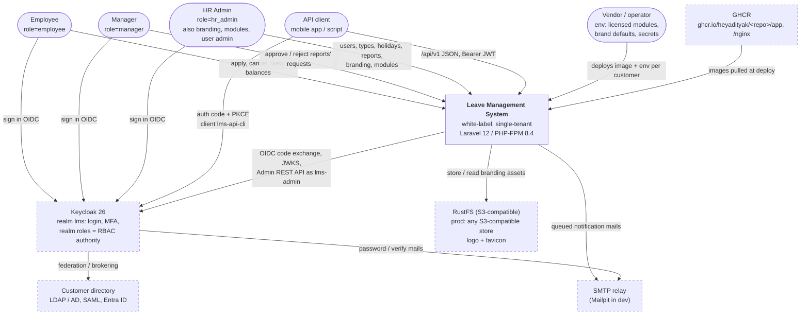
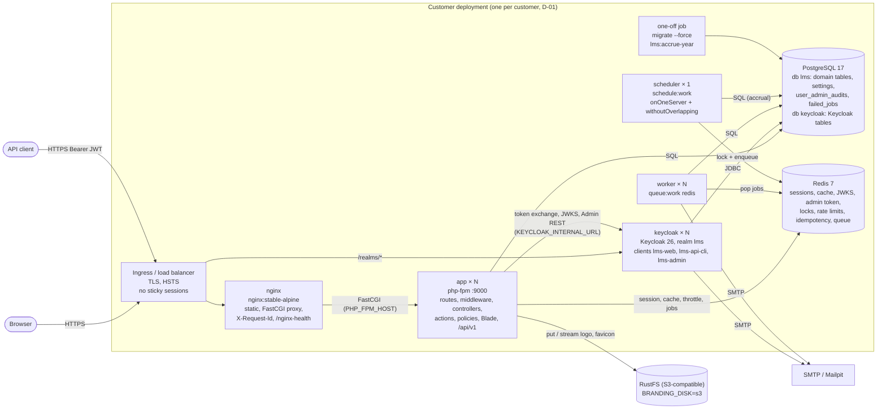
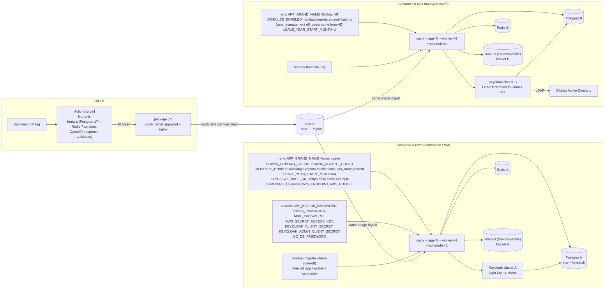
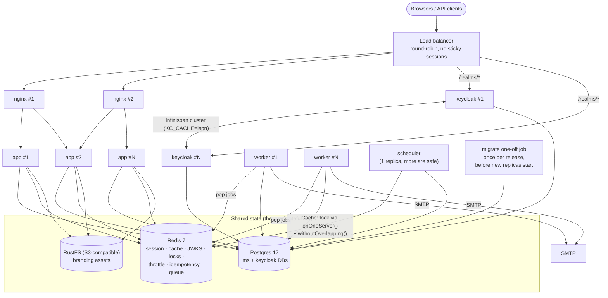

# 01 — System design (C4-style context, containers, deployment, scaling)

How the white-label LMS fits together at runtime and how it is shipped. Sources: [SYSTEM_DESIGN.md](../SYSTEM_DESIGN.md) §1–3, §8–11, §13 and ADRs D-01, D-09, D-14, D-15, D-20 (Keycloak), D-21 (API contract), D-22 (in-app user admin) in [decisions.md](../../.logs/decisions.md).

> **Redis, RustFS and horizontal scaling (coordinator requirements, 2026-11-19).** These diagrams show Redis 7 as the session, cache, lock, rate-limit and queue backend, RustFS (S3-compatible) as object storage, and `app` / `worker` as N stateless replicas. This replaces D-03 ("`database` driver, no Redis") and the local branding volume of D-15. The platform agent owns the superseding ADR and the SYSTEM_DESIGN §1/§3/§9 edits.

C4 notation is drawn with flowcharts, because Mermaid's `C4Context` is experimental and lays out poorly on GitHub. Shapes: person = stadium, container = rectangle, data store = cylinder, external system = dashed border.

## 1. System context (C4 level 1)

## 2. Containers (C4 level 2), one customer deployment

Notes:
- Every PHP process runs the **same `app` image** (D-09) with a different command. `nginx` and `keycloak` (`quay.io/keycloak/keycloak:26`) are separate images.
- `app` and `worker` are stateless: no local sessions, uploads or cache. Any replica serves any request, so no sticky sessions.
- Keycloak uses its own `keycloak` database on the same Postgres server (D-20). The browser reaches it at `KEYCLOAK_BASE_URL` (issuer); the app uses `KEYCLOAK_INTERNAL_URL` for back-channel calls.
- Health: nginx `/nginx-health`; app `/healthz` (no I/O) and `/readyz` (Postgres + Redis, **not** Keycloak, to avoid cascading restarts); Keycloak `/health/ready`.

## 3. Deployment view: build once, deploy per customer

Notes:
- **Build, release, run** (12-factor V): one immutable image per commit. Release = image digest + that customer's env. `config:cache`, `route:cache`, `view:cache` run in the entrypoint at container start.
- Env holds **defaults and the licensed ceiling** (D-14). Admin overrides (brand, disabled modules) are rows in that customer's `settings` table.
- Secrets come from the orchestrator (Kubernetes Secret, Docker secret, cloud secret manager) as env vars. Never in the image, never committed.
- Nothing is shared between customers: separate Postgres, Redis, Keycloak and bucket (D-01).
- Object storage is **RustFS (S3-compatible)** in dev/compose. In prod `AWS_ENDPOINT` / `AWS_BUCKET` / `AWS_USE_PATH_STYLE_ENDPOINT` may point at any S3-compatible store with no code change.

## 4. Horizontal scaling view

| Tier | Scale | Why it is safe |
|---|---|---|
| nginx | N | Stateless, only proxies to `PHP_FPM_HOST`. |
| app (php-fpm) | N (CPU / latency) | Sessions, cache, JWKS, admin token, idempotency keys in Redis; uploads on RustFS. `Settings` cache invalidated in Redis, so every replica sees changes on the next request. |
| worker | N (queue depth) | Redis queue pop is atomic. SIGTERM finishes the current job. |
| scheduler | 1 (extra replicas harmless) | `onOneServer()` takes a Redis atomic lock per run; `withoutOverlapping()` stops a long accrual overlapping itself. Accrual is idempotent anyway (unique ledger index). |
| keycloak | N | Clustered (Infinispan) with shared `keycloak` DB. The app keeps validating JWTs from the Redis-cached JWKS during short Keycloak outages. |
| migrations | one-off | Never in the web entrypoint, so N replicas don't race. Expand/contract for breaking changes. |
| Postgres / Redis / RustFS | managed | Outside the app's scaling unit. |
