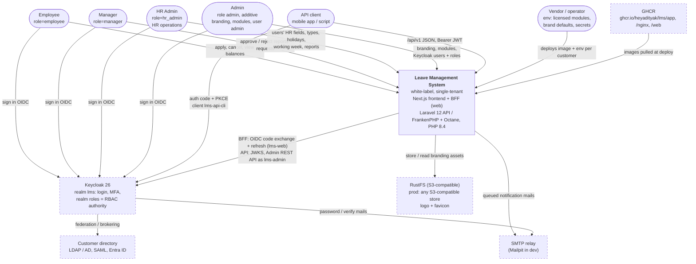
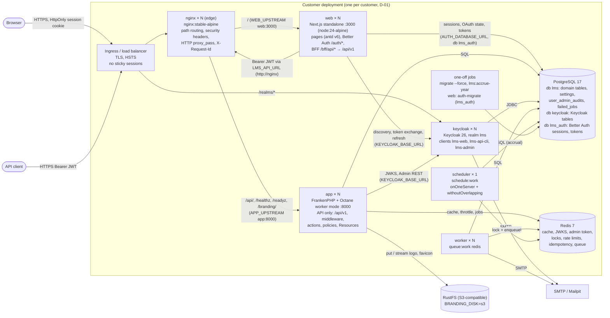
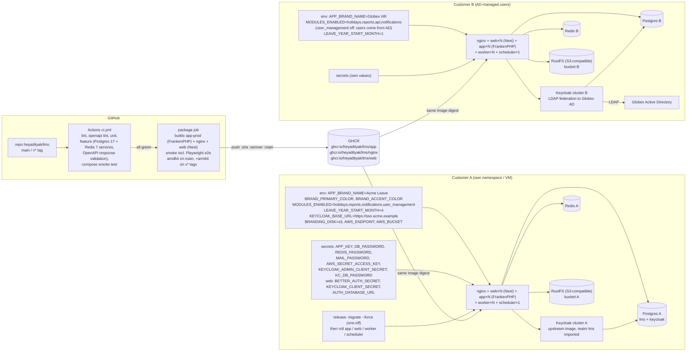
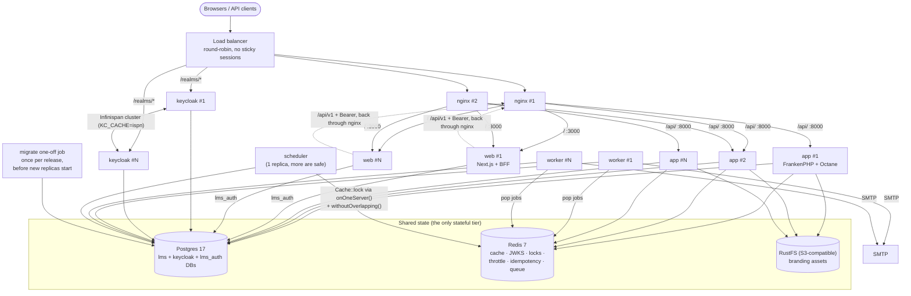

# 01 — System design (C4-style context, containers, deployment, scaling)

How the white-label LMS fits together at runtime and how it is shipped. Sources: [SYSTEM_DESIGN.md](../SYSTEM_DESIGN.md) §1–3, §8–11, §13 and ADRs D-01, D-09, D-14, D-15, D-20…D-27 in [decisions.md](../../.logs/decisions.md).

> Runtime choices shown here: Next.js frontend + BFF (`web`) and API-only Laravel on one origin behind NGINX (D-43), FrankenPHP + Octane app replicas (D-27), Redis 7 for sessions/cache/locks/rate limits/queue (D-23), RustFS (S3-compatible) object storage and first-class horizontal scaling (D-24), Keycloak identity on the upstream image (D-20, D-22, D-29, D-33), CI/GHCR (D-25).

C4 notation is drawn with flowcharts, because Mermaid's `C4Context` is experimental and lays out poorly on GitHub. Shapes: person = stadium, container = rectangle, data store = cylinder, external system = dashed border.

## 1. System context (C4 level 1)

## 2. Containers (C4 level 2), one customer deployment

Notes:
- `web` is the Next.js frontend and BFF (D-43): browsers only talk to `web` (pages, `/auth/*`, `/bff/*`) and to `/branding/*` assets; tokens stay server-side in the `lms_auth` database (Better Auth, D-45; the browser only has an HttpOnly session cookie) and are attached when the BFF calls `/api/v1` back through nginx. Third-party API clients call `/api/v1` directly.
- Every PHP process runs the **same `app` image** (FrankenPHP, D-09/D-27) with a different command: web = `php artisan octane:frankenphp` on `:8000` (or classic FrankenPHP with `APP_SERVER_MODE=classic`), worker = `queue:work`, scheduler = `schedule:work`, one-off = `migrate`. `nginx`, `web` and `keycloak` are separate images.
- NGINX is the edge reverse proxy: TLS in prod (or the platform LB), static files, security headers, `proxy_pass` over HTTP. FrankenPHP's own auto-HTTPS is off (`SERVER_NAME=:8000`).
- `web`, `app` and `worker` are stateless: no per-process session state (web sessions live in Postgres `lms_auth`, D-45), no local uploads or cache. Any replica serves any request, so no sticky sessions.
- Keycloak uses its own `keycloak` database on the same Postgres server (D-20). The browser reaches it at `KEYCLOAK_PUBLIC_URL` (issuer); `web` and `app` use `KEYCLOAK_BASE_URL` for back-channel calls.
- Health: nginx `/nginx-health`; web `:3000/bff/healthz` (no I/O); app (served by Octane, image `HEALTHCHECK` curls `:8000/healthz`) `/healthz` (no I/O) and `/readyz` (Postgres + Redis, **not** Keycloak, to avoid cascading restarts); Keycloak `/health/ready`.

## 3. Deployment view: build once, deploy per customer

Notes:
- **Build, release, run** (12-factor V): one immutable image per role per commit (`app`, `nginx`, `web`); the `web` image bakes in no deployment config (no `NEXT_PUBLIC_*`, D-43). Release = image digest + that customer's env. `config:cache`, `route:cache`, `view:cache` run in the entrypoint at container start.
- Env holds **defaults and the licensed ceiling** (D-14). Admin overrides (brand, disabled modules) are rows in that customer's `settings` table.
- Secrets come from the orchestrator (Kubernetes Secret, Docker secret, cloud secret manager) as env vars. Never in the image, never committed.
- Nothing is shared between customers: separate Postgres, Redis, Keycloak and bucket (D-01).
- Object storage is **RustFS (S3-compatible)** in dev/compose. In prod `AWS_ENDPOINT` / `AWS_BUCKET` / `AWS_USE_PATH_STYLE_ENDPOINT` may point at any S3-compatible store with no code change.

## 4. Horizontal scaling view

| Tier | Scale | Why it is safe |
|---|---|---|
| nginx | N | Stateless edge proxy to `WEB_UPSTREAM` and `APP_UPSTREAM` over HTTP (no FastCGI), re-resolved via `NGINX_RESOLVER`. |
| web (Next.js + BFF) | N (CPU / SSR latency) | Sessions, OAuth state, tokens and auth rate limits in Postgres `lms_auth` (Better Auth, D-45), 5-min JWE cookie cache readable by any replica (shared `BETTER_AUTH_SECRET`); per-replica fetch cache holds only public branding (≤ 30 s). |
| app (FrankenPHP + Octane) | N (CPU / latency); `OCTANE_WORKERS` per replica, recycled after `OCTANE_MAX_REQUESTS` | Bearer-only (no sessions); cache, JWKS, admin token, idempotency keys in Redis; uploads on RustFS. `Settings` cache invalidated in Redis, so every replica sees changes on the next request. |
| worker | N (queue depth) | Redis queue pop is atomic. SIGTERM finishes the current job. |
| scheduler | 1 (extra replicas harmless) | `onOneServer()` takes a Redis atomic lock per run; `withoutOverlapping()` stops a long run overlapping itself. Yearly accrual is idempotent via the ledger unique index (`month` null). Monthly accrual (00:15 on the 1st) is idempotent via the grant unique index that includes `month`. The 08:00 reminder is idempotent via `approval_reminders`. The 09:00 escalation is idempotent via `leave_requests.escalated_at`. |
| keycloak | N | Clustered (Infinispan) with shared `keycloak` DB. The app keeps validating JWTs from the Redis-cached JWKS during short Keycloak outages. |
| migrations | one-off | Never in the web entrypoint, so N replicas don't race. Expand/contract for breaking changes. |
| Postgres / Redis / RustFS | managed | Outside the app's scaling unit. |
