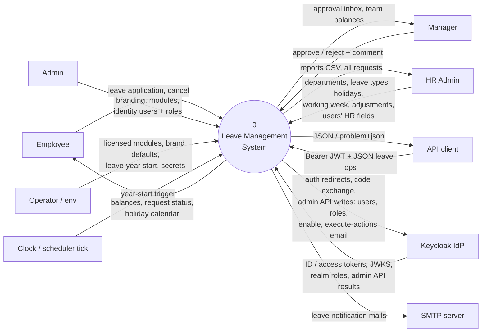
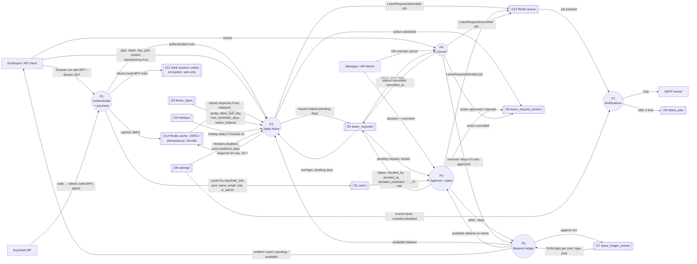
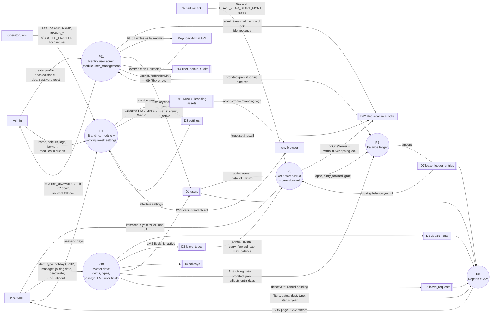

# 02 — Data flow diagrams (DFD)

Gane–Sarson style drawn with Mermaid flowcharts:

| Symbol | Meaning | Mermaid shape |
|---|---|---|
| Rectangle | External entity (outside the system) | `[ ]` |
| Circle | Process, numbered `P1…` | `(( ))` |
| Double-bar box | Data store, numbered `D1…` | `[[ ]]` |
| Arrow label | Data that flows | edge text |

Business rules come from [USE_CASES.md](../USE_CASES.md); tables from [SYSTEM_DESIGN.md](../SYSTEM_DESIGN.md) §4; Redis layout from D-23; Keycloak from D-20/D-22.

## Data stores

| Store | Backing | Tables / keys | Written by |
|---|---|---|---|
| D1 Users | Postgres | `users` (mirror of Keycloak identity + LMS fields) | P1, P10, P11 |
| D2 Departments | Postgres | `departments` | P10 |
| D3 Leave types | Postgres | `leave_types` | P10 |
| D4 Holidays | Postgres | `holidays` | P10 |
| D5 Leave requests | Postgres | `leave_requests` | P2, P3, P4 |
| D6 Request actions (audit) | Postgres | `leave_request_actions` | P2, P3, P4 |
| D7 Leave ledger | Postgres | `leave_ledger_entries` (append-only) | P5 only |
| D8 Settings | Postgres | `settings` (`brand.*`, `modules.disabled`, `work.weekend_days`) | P9 |
| D9 Failed jobs | Postgres | `failed_jobs` | P7 |
| D10 Branding assets | RustFS (S3-compatible), `BRANDING_DISK=s3` | `logo-{sha1}.{ext}`, `favicon-{sha1}.{ext}` | P9 |
| D11 Web session (browser cookie) | Encrypted Auth.js cookie held by the browser, readable only by `web` (`AUTH_SECRET`); no server store since D-43 | access, refresh and id token, `expires_at` | P1 |
| D12 Cache, locks, rate limits | Redis DB 1 | `settings:all`, `keycloak:jwks`, `keycloak:admin-token`, `idem:{user}:{key}`, schedule / guard locks, `throttle:*` | P1, P2, P6, P9, P11 |
| D13 Queue | Redis DB 3 | `queues:default` (notification jobs) | P2, P3, P4 → read by P7 |
| D14 User-admin audit | Postgres | `user_admin_audits` (append-only) | P11 |
| Config (not a store) | env | `MODULES_ENABLED`, `APP_BRAND_NAME`, `BRAND_*`, `LMS_WEEKEND_DAYS`, `LEAVE_YEAR_START_MONTH`, `KEYCLOAK_*` | operator at deploy |

## Level 0: context

Password, MFA and account mails are sent by Keycloak itself, not by the LMS.

## Level 1a: identity and leave lifecycle

## Level 1b: administration and system jobs

Notes:
- **P5 is the only writer of D7**, and it only appends. Balance is always derived (`SUM(days)`), never stored (D-02).
- P1 never sees a password. It receives tokens from Keycloak, verifies them against the cached JWKS (D12), and mirrors identity into D1 (`keycloak_sub`, name, email, role, is_admin).
- P11 writes **Keycloak first**, then D1. If the D1 write fails after a create, P11 deletes the Keycloak user again (compensation) and records it in D14.
- P9 never writes env. A module can be disabled only if it is licensed (D-14). `work.weekend_days` changes apply to new submissions only; stored `days` in D5 are never recalculated (D-30).
- P11 reads Keycloak live; when Keycloak is down it answers 503 `IDP_UNAVAILABLE` and never serves D1 as a stale list (D-32).
- `holidays` off ⇒ D4 is not read by P2 (D-17). `notifications` off ⇒ nothing is pushed to D13. `user_management` off ⇒ P11 does not exist; HR still edits LMS fields via P10.
