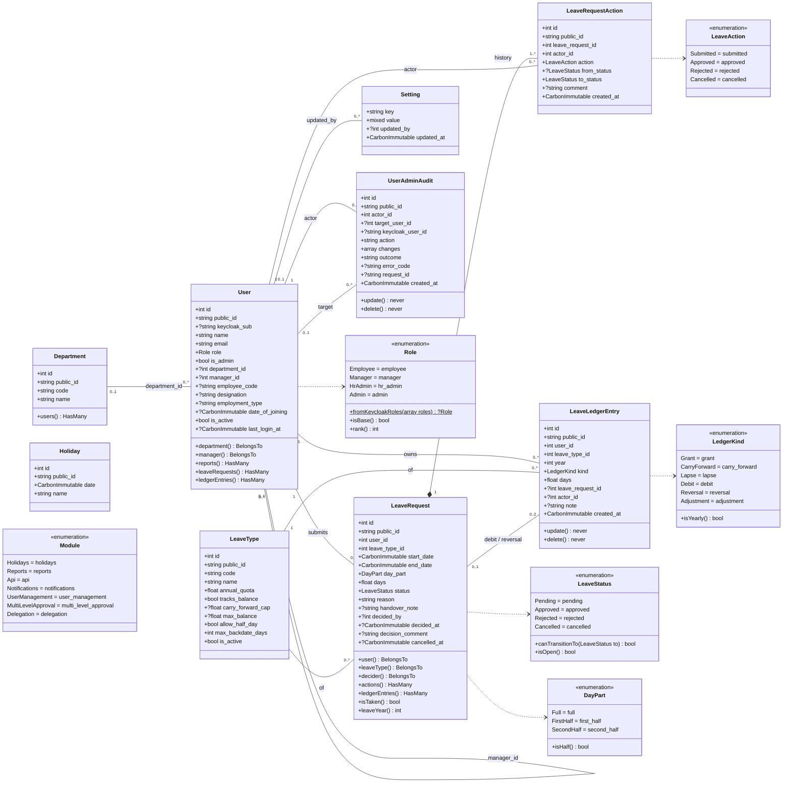
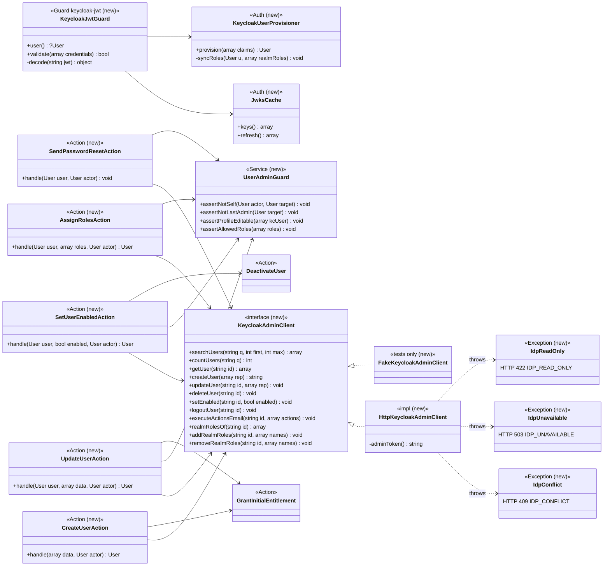

# 03 — Class diagrams

Split in four so each renders legibly on GitHub:

1. **Domain model**: Eloquent models + enums (tables from [SYSTEM_DESIGN.md](../SYSTEM_DESIGN.md) §4).
2. **Domain logic**: leave/accrual actions, services, scoped support services, console command, exceptions.
3. **Identity**: Keycloak login, JWT guard, provisioning, Keycloak Admin client and user-admin actions (D-20, D-22).
4. **HTTP + delivery**: controllers, form requests, policies, middleware, notifications, view composer.

Names follow [AGENTS.md](../../AGENTS.md) §3–4. Classes not named in the docs before this run are marked **(new)** and listed at the end; the domain agent adopts these names.

## 1. Domain model (models + enums)

Notes:
- Every API-exposed model uses `HasUlids` on `public_id` and `getRouteKeyName() = 'public_id'`; the bigint `id` is never serialised (D-21).
- `User` has no `password` / `remember_token`: Keycloak owns credentials (D-20). `role` is a cache of the base Keycloak realm role; `Role::fromKeycloakRoles()` picks the highest base role (`hr_admin` > `manager` > `employee`). `is_admin` caches the additive realm role `admin` (`Role::Admin`, never stored in `role`, D-29).
- Multiplicity `0..2` on ledger rows per request: at most one `debit` and one `reversal`.
- `LeaveLedgerEntry` and `UserAdminAudit` throw `LogicException` on `update()` / `delete()` (append-only).

## 2. Domain logic (leave, accrual, settings)

```mermaid
classDiagram
    direction TB

    class SubmitLeaveRequest {
        <<Action>>
        +handle(User user, array data) LeaveRequest
    }
    class ApproveLeaveRequest {
        <<Action>>
        +handle(LeaveRequest request, User actor, ?string comment) LeaveRequest
    }
    class RejectLeaveRequest {
        <<Action>>
        +handle(LeaveRequest request, User actor, string comment) LeaveRequest
    }
    class CancelLeaveRequest {
        <<Action>>
        +handle(LeaveRequest request, User actor, ?string comment) LeaveRequest
    }
    class GrantInitialEntitlement {
        <<Action>>
        +handle(User user) void
    }
    class RunYearStartAccrual {
        <<Action>>
        +handle(int year) AccrualSummary
    }
    class AdjustBalance {
        <<Action (new)>>
        +handle(User user, LeaveType type, float days, string note, User actor) LeaveLedgerEntry
    }
    class DeactivateUser {
        <<Action>>
        +handle(User user, User actor) void
    }
    class UpdateBranding {
        <<Action (new)>>
        +handle(array data, ?UploadedFile logo, ?UploadedFile favicon, User actor) void
    }
    class ResetBranding {
        <<Action (new)>>
        +handle(User actor) void
    }
    class UpdateModules {
        <<Action (new)>>
        +handle(array disabled, User actor) void
    }
    class UpdateWorkingWeek {
        <<Action (new)>>
        +handle(?array weekendIsoDays, User actor) void
    }

    class LeaveRequestValidator {
        <<Service>>
        +validate(User user, array data) array
        +assertNoOverlap(User user, start, end, ?int exceptRequestId)$ void
    }
    class WorkingDayCalculator {
        <<Service>>
        +count(start, end, DayPart part, array weekendIsoDays, array holidayDates)$ float
        +forRange(start, end, DayPart part) float
    }
    class LeaveBalanceService {
        <<Service>>
        +balance(User u, LeaveType t, int year) float
        +pending(User u, LeaveType t, int year, ?int exceptRequestId) float
        +available(User u, LeaveType t, int year, ?int exceptRequestId) float
        +summary(User u, int year) array
    }
    class ApproverResolver {
        <<Service (new)>>
        +approversFor(User requester) Collection
        +canDecide(User actor, LeaveRequest r) bool
    }
    class AccrualCalculator {
        <<Service (new), pure>>
        +prorate(float quota, int joinMonth, int startMonth)$ float
        +carry(float closing, ?float cap)$ float
        +clipGrant(float grant, float carry, ?float maxBalance)$ float
        +floorToHalf(float days)$ float
    }
    class LeaveYear {
        <<Support (new)>>
        +of(CarbonInterface date)$ int
        +start(int year)$ CarbonImmutable
        +end(int year)$ CarbonImmutable
        +current()$ int
    }
    class Settings {
        <<Support, scoped binding>>
        +get(string key) mixed
        +set(string key, mixed value, User actor) void
        +forget(string key) void
    }
    class Modules {
        <<Support, scoped binding>>
        +enabled(Module m) bool
        +licensed() array
        +all() array
        +resolve(array licensed, array registry, array disabled)$ array
    }
    class BrandColor {
        <<Support (new), pure>>
        +isValidHex(string hex)$ bool
        +contrast(string hex)$ string
    }
    class AccrueYear {
        <<Console command>>
        signature lms:accrue-year year?
        +handle(RunYearStartAccrual action) int
    }
    class InvalidTransition {
        <<Exception>>
        HTTP 409 INVALID_TRANSITION
    }
    class LeaveRuleViolation {
        <<Exception (new)>>
        HTTP 422 with problem code
        +string code
        +string field
    }
    class AccrualSummary {
        <<DTO (new)>>
        +int year
        +int users
        +int rowsWritten
        +int rowsSkipped
    }

    SubmitLeaveRequest --> LeaveRequestValidator
    SubmitLeaveRequest --> ApproverResolver
    SubmitLeaveRequest ..> LeaveRuleViolation : throws
    LeaveRequestValidator --> WorkingDayCalculator
    LeaveRequestValidator --> LeaveBalanceService
    LeaveRequestValidator --> ApproverResolver
    LeaveRequestValidator ..> LeaveYear : of, end
    LeaveRequestValidator ..> LeaveRuleViolation : throws
    ApproveLeaveRequest --> LeaveBalanceService
    ApproveLeaveRequest --> ApproverResolver
    ApproveLeaveRequest ..> LeaveRequestValidator : assertNoOverlap
    ApproveLeaveRequest ..> InvalidTransition : throws
    ApproveLeaveRequest ..> LeaveRuleViolation : throws
    RejectLeaveRequest ..> InvalidTransition : throws
    CancelLeaveRequest ..> InvalidTransition : throws
    GrantInitialEntitlement --> AccrualCalculator
    GrantInitialEntitlement --> LeaveYear
    RunYearStartAccrual --> AccrualCalculator
    RunYearStartAccrual --> LeaveBalanceService
    RunYearStartAccrual --> LeaveYear
    RunYearStartAccrual --> AccrualSummary
    AccrueYear --> RunYearStartAccrual
    DeactivateUser --> CancelLeaveRequest
    WorkingDayCalculator --> Modules
    WorkingDayCalculator --> Settings : work.weekend_days
    UpdateWorkingWeek --> Settings
    UpdateBranding --> Settings
    UpdateBranding --> BrandColor
    ResetBranding --> Settings
    UpdateModules --> Settings
    UpdateModules --> Modules
    Modules --> Settings
```

Notes:
- Every action is `final`, has one public `handle()`, runs in `DB::transaction`, uses `lockForUpdate()` (`SubmitLeaveRequest` locks the requester's `users` row; approve/reject/cancel lock the `leave_requests` row), and dispatches notifications with `afterCommit()`.
- `LeaveRequestValidator` (D-49) owns rules V1–V8. `SubmitLeaveRequest` calls `validate()` inside that user-row lock and still injects `ApproverResolver` to notify approvers. The validator constructor takes `WorkingDayCalculator`, `LeaveBalanceService` and `ApproverResolver`; `LeaveYear::of` and `LeaveYear::end` are static calls (`..>`). `ApproveLeaveRequest` calls only the static `assertNoOverlap()` (V6) and still injects `LeaveBalanceService` for the balance re-check. `POST /leave-requests/preview` calls `validate()` with no lock and no write.
- Pure static helpers (`WorkingDayCalculator::count`, `AccrualCalculator`, `BrandColor`, `Modules::resolve`, `LeaveStatus::canTransitionTo`, `Role::fromKeycloakRoles`) are what the Unit suite tests without booting Laravel.
- `AccrueYear` is scheduled with `onOneServer()->withoutOverlapping()` (Redis locks) on day 1 of `LEAVE_YEAR_START_MONTH`.

## 3. Identity: Keycloak login, JWT guard, user administration

Notes:
- `KeycloakAdminClient` is bound to `HttpKeycloakAdminClient` in a service provider; Feature tests bind `FakeKeycloakAdminClient`. Nothing else talks to the Admin REST API.
- `HttpKeycloakAdminClient::adminToken()` gets a client-credentials token for `lms-admin` and caches it in Redis until 30 s before expiry.
- All user-admin actions write one `UserAdminAudit` row each (success or failure) and are gated by module `user_management` + realm role `admin` (D-29). Keycloak unavailable ⇒ `IdpUnavailable` (503) also for list/detail; no local fallback (D-32).
- `UpdateUserAction` also serves the plain LMS-field edit (`PATCH /users/{id}`, module off): then it never calls Keycloak.

## 4. HTTP layer, policies, middleware, notifications

```mermaid
classDiagram
    direction LR

    class LeaveRequestController {
        <<Api V1>>
        +index()
        +store(StoreLeaveRequestRequest r, SubmitLeaveRequest a)
        +preview(StoreLeaveRequestRequest r, LeaveRequestValidator v)
        +show(LeaveRequest lr)
        +cancel(CancelLeaveRequestRequest r, LeaveRequest lr, CancelLeaveRequest a)
    }
    class ApprovalController {
        <<Api V1>>
        +index()
        +approve(ApproveLeaveRequestRequest r, LeaveRequest lr, ApproveLeaveRequest a)
        +reject(RejectLeaveRequestRequest r, LeaveRequest lr, RejectLeaveRequest a)
    }
    class AdminUserController {
        <<Api V1 Admin>>
        +index()
        +store(StoreIdentityUserRequest r, CreateUserAction a)
        +show(User u)
        +update(UpdateIdentityUserRequest r, User u, UpdateUserAction a)
        +roles(SetUserRolesRequest r, User u, AssignRolesAction a)
        +enable(User u, SetUserEnabledAction a)
        +disable(User u, SetUserEnabledAction a)
        +passwordReset(User u, SendPasswordResetAction a)
    }
    class BrandingController {
        <<Api V1>>
        +show()
        +update(UpdateBrandingRequest r, UpdateBranding a)
        +destroy(string asset)
    }
    class ModuleController {
        <<Api V1>>
        +index()
        +update(UpdateModulesRequest r, UpdateModules a)
    }
    class WorkingWeekController {
        <<Api V1>>
        +show()
        +update(UpdateWorkingWeekRequest r, UpdateWorkingWeek a)
    }
    class BrandingAssetController {
        <<public, no auth>>
        +show(string asset) StreamedResponse
    }
    class PublicBrandingController {
        <<Api V1 public, no auth (D-43)>>
        +__invoke(Settings s, Modules m) JsonResponse
    }
    class HealthController {
        +healthz() JsonResponse
        +readyz() JsonResponse
    }

    class StoreLeaveRequestRequest {
        <<FormRequest>>
    }
    class ApproveLeaveRequestRequest {
        <<FormRequest>>
    }
    class RejectLeaveRequestRequest {
        <<FormRequest>>
        comment required
    }
    class CancelLeaveRequestRequest {
        <<FormRequest>>
    }
    class StoreIdentityUserRequest {
        <<FormRequest (new)>>
    }
    class UpdateIdentityUserRequest {
        <<FormRequest (new)>>
    }
    class SetUserRolesRequest {
        <<FormRequest (new)>>
        allow-list, one base role + optional admin
    }
    class UpdateBrandingRequest {
        <<FormRequest>>
        hex, png jpg webp, no svg
    }
    class UpdateModulesRequest {
        <<FormRequest>>
        keys subset of licensed
    }
    class UpdateWorkingWeekRequest {
        <<FormRequest (new)>>
        ISO 1-7, distinct, max 6, or null
    }

    class LeaveRequestPolicy {
        <<Policy>>
        +view(User u, LeaveRequest r) bool
        +create(User u) bool
        +cancel(User u, LeaveRequest r) bool
        +decide(User u, LeaveRequest r) bool
    }
    class UserPolicy {
        <<Policy>>
        view: self, manager-of, hr_admin
        update: hr_admin
        manageIdentity: admin
    }
    class SettingsPolicy {
        <<Policy>>
        manageBranding, manageModules: admin
        updateWorkingWeek: hr_admin
    }

    class EnsureModuleEnabled {
        <<Middleware alias module>>
        +handle(Request r, Closure next, string module) 404 if off
    }
    class EnsureUserIsActive {
        <<Middleware alias active>>
    }
    class EnsureIdempotency {
        <<Middleware alias idempotent (new)>>
        Redis 24 h, replay or 409 or 422
    }
    class RequestId {
        <<Middleware>>
    }

    class LeaveRequestSubmitted {
        <<Notification ShouldQueue>>
        to approvers
    }
    class LeaveRequestDecided {
        <<Notification ShouldQueue>>
        to requester
    }
    class LeaveRequestCancelled {
        <<Notification ShouldQueue>>
        to other party
    }
    class Brand {
        <<DTO (new)>>
        +string name
        +string primary
        +string accent
        +string contrast
        +string logoUrl
        +string faviconUrl
    }

    LeaveRequestController ..> StoreLeaveRequestRequest
    LeaveRequestController ..> CancelLeaveRequestRequest
    LeaveRequestController ..> LeaveRequestPolicy : authorize
    LeaveRequestController ..> EnsureIdempotency : store
    ApprovalController ..> ApproveLeaveRequestRequest
    ApprovalController ..> RejectLeaveRequestRequest
    ApprovalController ..> LeaveRequestPolicy : decide
    AdminUserController ..> StoreIdentityUserRequest
    AdminUserController ..> UpdateIdentityUserRequest
    AdminUserController ..> SetUserRolesRequest
    AdminUserController ..> UserPolicy
    AdminUserController ..> EnsureIdempotency : store
    BrandingController ..> UpdateBrandingRequest
    BrandingController ..> SettingsPolicy
    ModuleController ..> UpdateModulesRequest
    ModuleController ..> SettingsPolicy
    WorkingWeekController ..> UpdateWorkingWeekRequest
    WorkingWeekController ..> SettingsPolicy
    PublicBrandingController --> Brand
    LeaveRequestSubmitted ..> Brand : subject prefix
    LeaveRequestDecided ..> Brand
```

Notes:
- Laravel is API-only (D-43): controllers live in `App\Http\Controllers\Api\V1\…` (JSON Resources `LeaveRequestResource`, `UserResource`, `IdentityUserResource`, `BalanceResource`, `LedgerEntryResource`, …) and call the Actions. Pages are in the Next.js frontend (`web/`), which reaches these controllers through its BFF.
- `LeaveRequestController::preview` reuses `StoreLeaveRequestRequest` (same `create` policy and V9 shape as `store`) and `LeaveRequestValidator`. It is not behind `EnsureIdempotency` (D-49).
- Admin CRUD controllers for departments, leave types, holidays, adjustments and reports follow the same pattern and are omitted; so are `DepartmentPolicy`, `LeaveTypePolicy`, `HolidayPolicy` (all `hr_admin` for writes).
- Errors for `api/*` are rendered as `application/problem+json` in `bootstrap/app.php` `withExceptions()`, mapping `InvalidTransition`, `LeaveRuleViolation`, `Idp*` and framework exceptions to the codes in [API_GUIDELINES.md](../API_GUIDELINES.md) §4.
- No `AccountCreated` notification and no token controller: Keycloak handles account mails and tokens (D-20).

## Class names the domain agent must adopt

Already named in the docs: `User`, `Department`, `LeaveType`, `Holiday`, `LeaveRequest`, `LeaveRequestAction`, `LeaveLedgerEntry`, `Setting`; enums `Role`, `LeaveStatus`, `DayPart`, `LedgerKind`, `LeaveAction`, `Module`; `SubmitLeaveRequest`, `ApproveLeaveRequest`, `RejectLeaveRequest`, `CancelLeaveRequest`, `GrantInitialEntitlement`, `RunYearStartAccrual`, `DeactivateUser`, `WorkingDayCalculator`, `LeaveBalanceService`, `Settings`, `Modules`, `AccrueYear`, `InvalidTransition`, `EnsureModuleEnabled`, `EnsureUserIsActive`, `RequestId`, `HealthController`, `LeaveRequestPolicy`, `UserPolicy`, `DepartmentPolicy`, `LeaveTypePolicy`, `HolidayPolicy`, `SettingsPolicy`, `LeaveRequestSubmitted`, `LeaveRequestDecided`, `LeaveRequestCancelled`.

New (introduced by this run, D-20/D-21/D-22):

| Class | Namespace | Purpose |
|---|---|---|
| `UserAdminAudit` | `App\Models` | `user_admin_audits` rows (append-only) |
| `KeycloakJwtGuard`, `JwksCache`, `KeycloakUserProvisioner` | `App\Auth` | Bearer JWT guard `keycloak-jwt`, cached JWKS, first-login provisioning + role sync |
| `KeycloakAdminClient` (interface), `HttpKeycloakAdminClient` | `App\Support\Keycloak` | Admin REST API wrapper (`lms-admin` service account) |
| `FakeKeycloakAdminClient` | `Tests\Fakes` | Test double (QA) |
| `CreateUserAction`, `UpdateUserAction`, `AssignRolesAction`, `SetUserEnabledAction`, `SendPasswordResetAction` | `App\Actions\Users` | UC-U2…U6 and UC-H2 |
| `UserAdminGuard` | `App\Services` | Guardrails G2–G5 |
| `IdpConflict`, `IdpUnavailable`, `IdpReadOnly`, `LeaveRuleViolation` | `App\Exceptions` | Map to problem codes |
| `EnsureIdempotency` | `App\Http\Middleware` (alias `idempotent`) | `Idempotency-Key` handling |
| `AdminUserController` | `App\Http\Controllers\Api\V1\Admin` | Identity admin endpoints |
| `StoreIdentityUserRequest`, `UpdateIdentityUserRequest`, `SetUserRolesRequest` | `App\Http\Requests` | Form Requests for identity admin |
| `AdjustBalance` | `App\Actions\Accrual` | UC-H5 `adjustment` ledger row |
| `UpdateBranding`, `ResetBranding`, `UpdateModules` | `App\Actions\Settings` | UC-B1–B6 |
| `UpdateWorkingWeek`, `WorkingWeekController`, `UpdateWorkingWeekRequest` | `App\Actions\Settings`, controllers, `App\Http\Requests` | UC-H16 weekend override (D-30) |
| `ApproverResolver`, `AccrualCalculator` | `App\Services` | Approver resolution; pure accrual maths |
| `LeaveRequestValidator` | `App\Services` | V1–V8 `validate()` plus static `assertNoOverlap()` (D-49), shared by submit, approve and preview |
| `AccrualSummary` | `App\Actions\Accrual` | Return value of `RunYearStartAccrual` |
| `LeaveYear`, `BrandColor`, `Brand` | `App\Support` | Leave-year maths (`LEAVE_YEAR_START_MONTH`), hex/contrast, brand DTO (public branding + mail) |
| `LeaveRequestController`, `ApprovalController`, `BrandingController`, `ModuleController`, `PublicBrandingController` | `App\Http\Controllers\Api\V1` | Controllers (D-43: no Web controllers) |
| `BrandingAssetController` | `App\Http\Controllers` | `/branding/{asset}` (default asset when not overridden) |
| `StoreLeaveRequestRequest`, `ApproveLeaveRequestRequest`, `RejectLeaveRequestRequest`, `CancelLeaveRequestRequest`, `UpdateBrandingRequest`, `UpdateModulesRequest` | `App\Http\Requests` | Form Requests |
