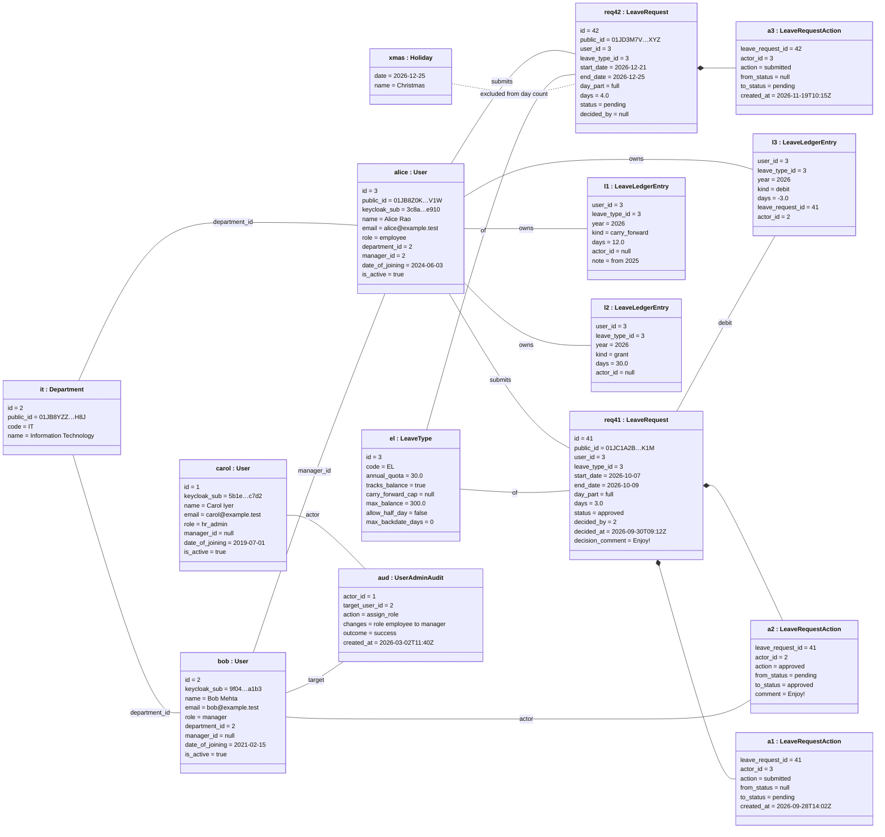

# 04 — Object diagram (snapshot)

Mermaid has no native object diagram, so this uses `classDiagram` with **instance boxes** named `object : Class` and attribute *values* instead of types. It is a snapshot of one deployment on **2026-11-19** with `LEAVE_YEAR_START_MONTH=1` (calendar leave year), `LMS_WEEKEND_DAYS=6,7` and the `holidays` module on. Ids are shortened ULIDs (`public_id`); bigint ids are shown only where they explain foreign keys.

Story:
- Alice (employee, IT) reports to Bob (manager). Carol is the HR admin. All three are the dev users from the Keycloak realm import.
- Alice carried 12 EL days from 2025 and got the 30-day EL grant on 2026-01-01.
- Request #41: EL 2026-10-07 (Wed) … 2026-10-09 (Fri) = **3 days**, approved by Bob → `debit −3`.
- Request #42: EL 2026-12-21 (Mon) … 2026-12-25 (Fri). 25 Dec is a holiday, so **4 days**. Still `pending`.

Balances for Alice, EL, leave year 2026:

| Figure | Formula | Value |
|---|---|---|
| balance | SUM(ledger) = 12 + 30 − 3 | **39.0** |
| used | −(debit + reversal) = −(−3) | 3.0 |
| pending | SUM(days of pending requests in 2026) = 4 | 4.0 |
| available | balance − pending = 39 − 4 | **35.0** |
| entitled | carry_forward + grant (+ lapse + adjustment) = 12 + 30 | 42.0 |

Checks:
- No ledger row for req42: pending requests reduce **available** (35) but not **balance** (39). A debit is written only on approval (USE_CASES §3.5).
- req41 and req42 do not overlap, so the Postgres exclusion constraint accepts both.
- 12 + 30 = 42 ≤ `max_balance` 300, so the grant was not clipped. EL `carry_forward_cap = null`, so the 2025 closing balance carried in full and no `lapse` row exists.
- If Alice cancels req41 before 2026-10-07 (not possible any more: it has started), a `reversal +3` would bring balance back to 42. If Bob approves req42 now, a `debit −4` makes balance 35 = available.
- The audit row records Carol promoting Bob through UC-U6 (Keycloak first, then the local `role` mirror).
