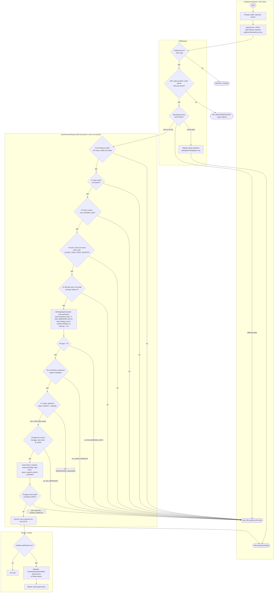
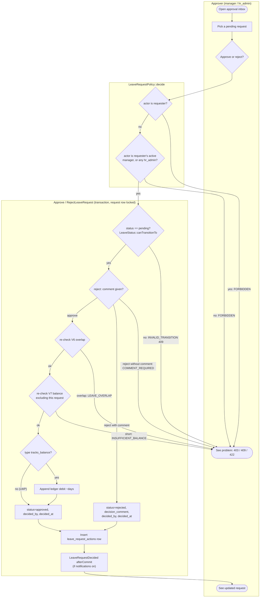
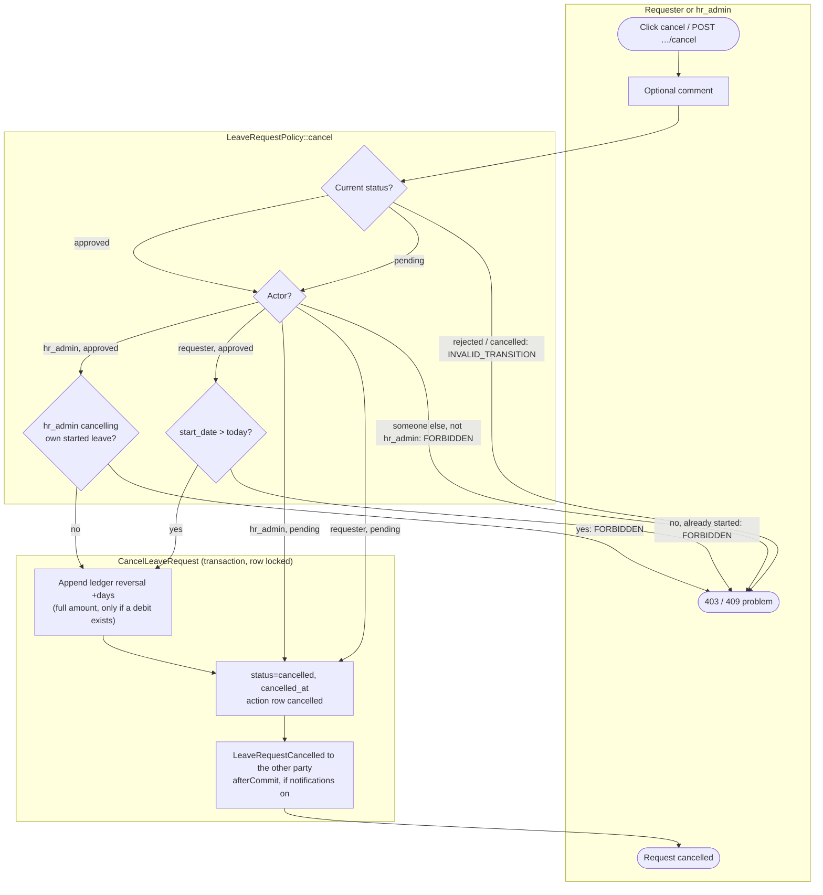
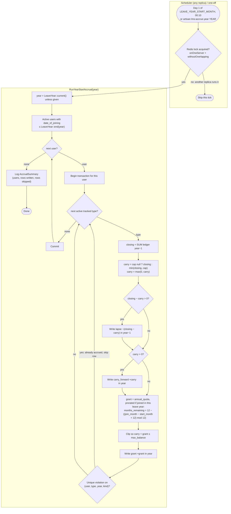
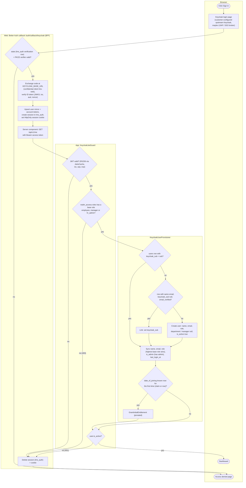
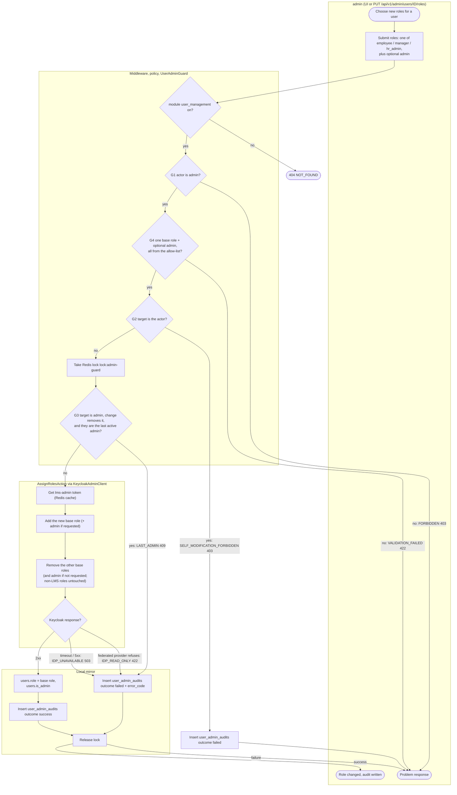

# 05 — Activity diagrams

UML activity diagrams drawn as Mermaid flowcharts. **Swimlanes are subgraphs** (one per actor or layer). Rounded boxes are actions, diamonds are decisions, stadiums are start/end. Rule ids (V1–V9, G1–G7) refer to [USE_CASES.md](../USE_CASES.md) §3.4 and §3.11; error codes to [API_GUIDELINES.md](../API_GUIDELINES.md) §4.

## 1. Apply for leave (UC-E5)

Notes: the error path rolls the transaction back, so nothing is half-written. The `users` row lock serialises concurrent submissions of the same user; the exclusion constraint is the backstop if the lock is bypassed (D-06).

## 2. Approve or reject (UC-M2, UC-M3, UC-H6)

## 3. Cancel (UC-E7, HR override)

The reversal is unique per request (partial unique index `(leave_request_id, kind)`), so a retried cancel can never refund twice.

## 4. Year-start accrual and carry-forward (UC-S1, UC-H9)

Idempotent twice over: the Redis lock prevents concurrent runs, and the partial unique index makes a re-run write nothing new (`insertOrIgnore`).

## 5. White-label and working-week settings update (UC-B1–B6, UC-H16)

```mermaid
flowchart TB
    subgraph ADM["admin (D-29)"]
        s([Open Settings]) --> what{"Branding or modules?"}
        ok([Saved, page re-themed])
        e([422 with field errors])
    end

    subgraph HRL["hr_admin"]
        ws([Open Working week]) --> wsub["Submit weekend_days<br/>or null = reset"]
    end

    subgraph WW["UpdateWorkingWeek (D-30)"]
        w1{"each 1–7, distinct,<br/>at least one working day?"}
        w2["Upsert settings work.weekend_days<br/>(null = delete row, back to LMS_WEEKEND_DAYS)<br/>existing leave_requests.days untouched"]
    end

    subgraph BR["UpdateBranding / ResetBranding"]
        b1{"name 1–60 chars,<br/>colours match ^#RRGGBB?"}
        b2{"logo: png/jpg/webp ≤ 1 MB ≤ 1024px?<br/>favicon: png/ico ≤ 256 KB?<br/>SVG rejected"}
        b3["Store file on BRANDING_DISK (RustFS / S3)<br/>as logo-sha1.ext"]
        b4["Upsert settings rows brand.*<br/>(reset = delete rows)"]
    end

    subgraph MOD["UpdateModules"]
        m1["Load licensed = MODULES_ENABLED (env)<br/>and registry available flags"]
        m2{"Every module to enable is<br/>licensed AND available?"}
        m3["settings modules.disabled =<br/>licensed − enabled by admin"]
    end

    subgraph CACHE["Settings / Redis"]
        c1["Cache::forget settings:all"]
        c2["Next request on any replica:<br/>effective = DB override ?? env default"]
    end

    what -- branding --> b1
    b1 -- no --> e
    b1 -- yes --> b2
    b2 -- no --> e
    b2 -- yes --> b3 --> b4 --> c1
    what -- modules --> m1 --> m2
    m2 -- "no: MODULE_NOT_LICENSED" --> e
    m2 -- yes --> m3 --> c1
    wsub --> w1
    w1 -- "no: VALIDATION_FAILED" --> e
    w1 -- yes --> w2 --> c1
    c1 --> c2 --> ok
```

An `admin` can only **switch off** what the env licenses; an unlicensed module can never be switched on from the UI or API (D-14). Disabled modules return 404 and disappear from menus (D-17). A weekend change only affects requests submitted afterwards; stored `days` are never recalculated (D-30).

## 6. First-login provisioning (UC-E1, USE_CASES §3.10, D-43)

Laravel has no login callback any more (D-43): the first API call with a new `sub` is the first login, whether it comes from the web BFF (`azp` = `lms-web`) or a third-party API client, so both are provisioned identically.

## 7. Role change guardrails (UC-U6, G1–G7)

The last-admin count (active users with `is_admin`) uses the local mirror under a Redis lock so two concurrent demotions cannot both pass. Disable (UC-U4) applies the same G2/G3 checks. Drift with Keycloak (roles changed directly in the Keycloak console) is repaired at the user's next login by the provisioner.
