# 06 — Sequence diagrams

Runtime interactions. `App` is a FrankenPHP replica running Laravel Octane in worker mode on `:8000` (D-27); NGINX proxies to it over plain HTTP (no FastCGI). Redis logical DBs follow D-23 (cache 1, session 2, queue 3). Keycloak details follow D-20/D-22; API conventions follow [API_GUIDELINES.md](../API_GUIDELINES.md).

| # | Flow |
|---|---|
| 1 | Web login (OIDC auth code + PKCE, provisioning, Redis session) |
| 2 | RP-initiated logout |
| 3 | API call with a Keycloak Bearer JWT (JWKS cached in Redis) |
| 4 | Apply for leave (web), queue, worker, mail |
| 5 | Approve leave |
| 6 | Cancel approved leave with ledger refund |
| 7 | Scheduled year-start accrual (Redis lock, idempotent) |
| 8 | `/readyz` health check |
| 9 | Logo upload to RustFS + theme render via CSS variables |
| 10 | API error handling and `Idempotency-Key` |
| 11 | Admin creates a user (Keycloak first, compensation on failure) |

## 1. Web login: OIDC authorization code flow

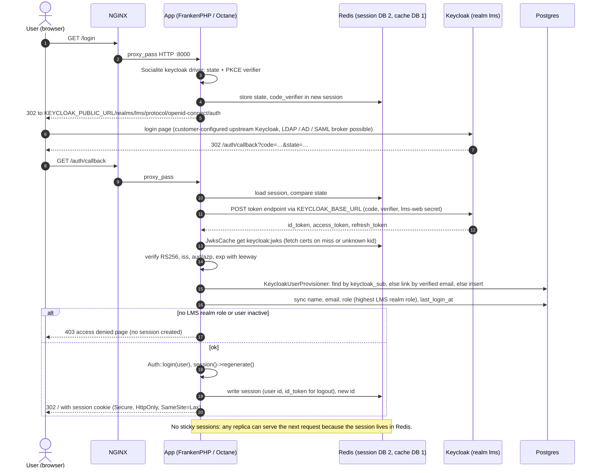

## 2. RP-initiated logout

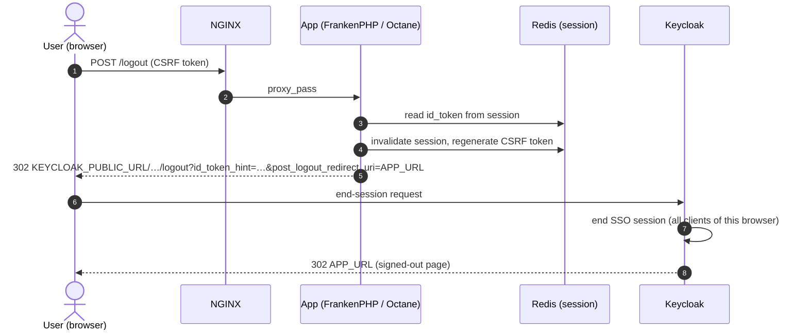

## 3. API call with a Keycloak Bearer JWT

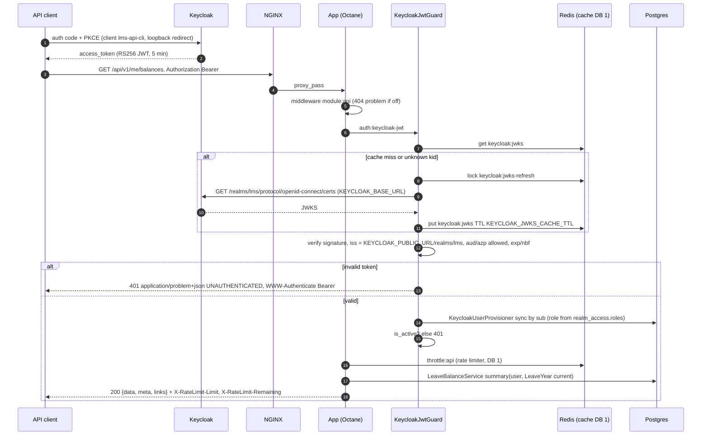

## 4. Apply for leave (web), queue and mail

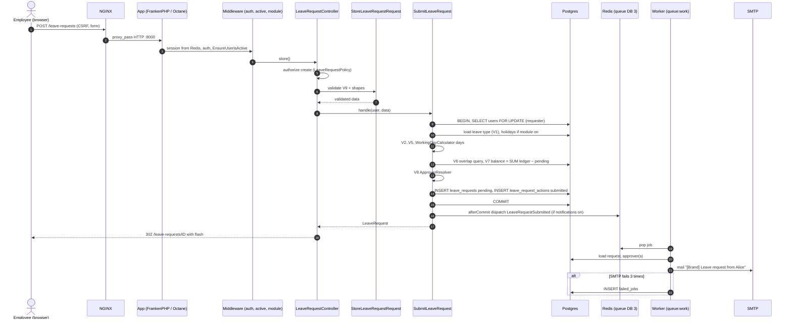

## 5. Approve leave

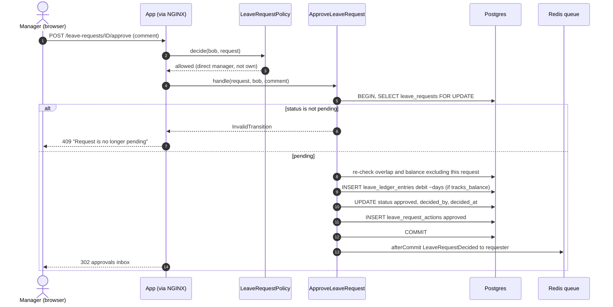

## 6. Cancel an approved leave with ledger refund

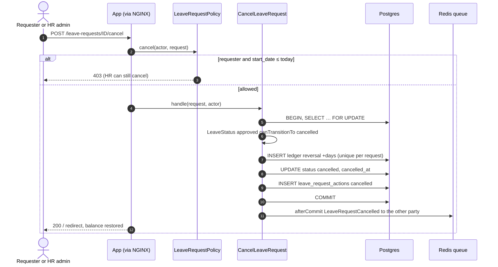

## 7. Scheduled year-start accrual (idempotent)

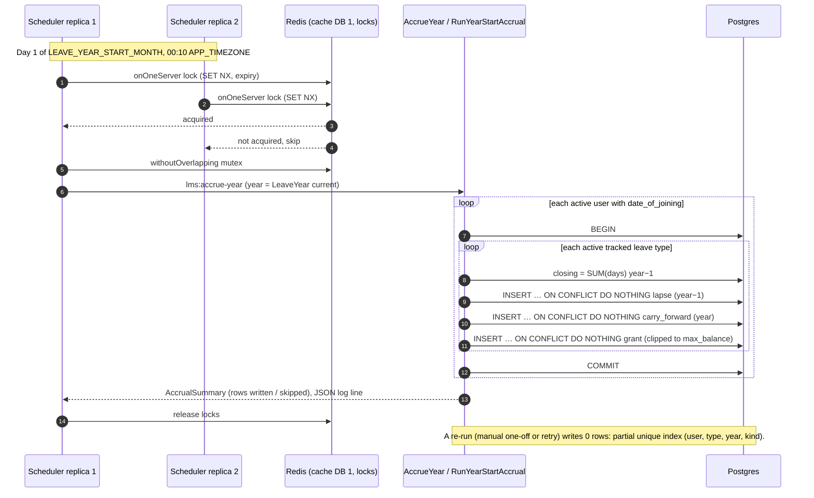

## 8. Readiness check `/readyz`

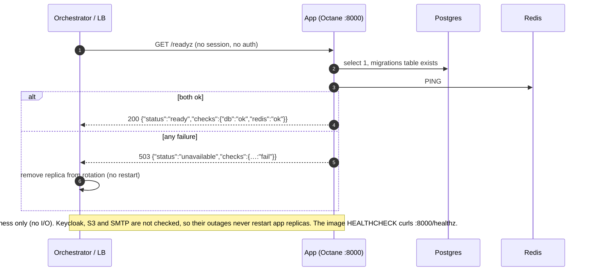

## 9. Logo upload to RustFS and theme render

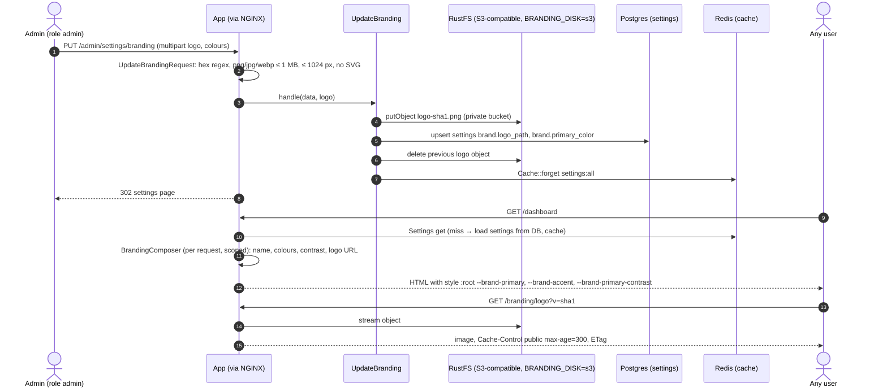

## 10. API error handling and `Idempotency-Key`

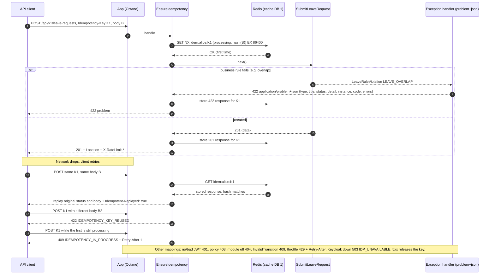

## 11. Admin creates a user (Keycloak first, compensation)

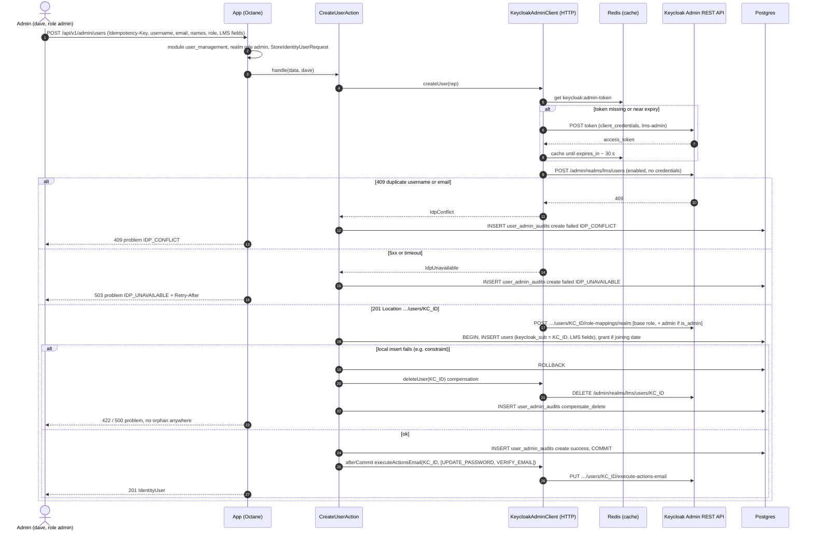

If the compensation delete itself fails (Keycloak went down mid-flight), the audit row records `compensate_delete` with outcome `failed` and the Keycloak id, so an admin can clean up; the next login of that identity would otherwise be provisioned normally.
