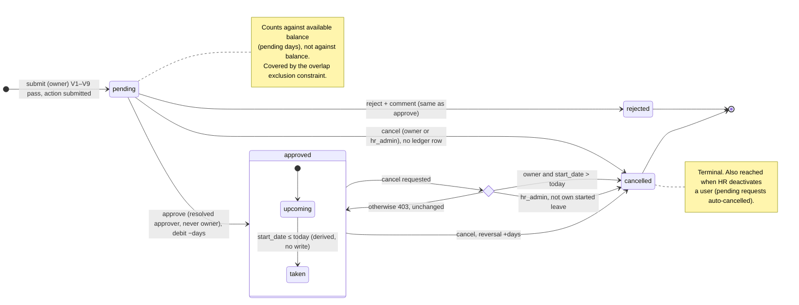

# 07 — State diagram: leave request lifecycle

Statuses are the `LeaveStatus` enum (`pending`, `approved`, `rejected`, `cancelled`, D-07). There is no `draft`; `taken` is **derived** (approved and `start_date ≤ today`), never stored. Allowed edges live in `LeaveStatus::canTransitionTo()`; *who* may fire them is decided by `LeaveRequestPolicy` (USE_CASES §3.6). Any other edge throws `InvalidTransition` → 409 `INVALID_TRANSITION`.

| From → To | Event | Who | Ledger | Notification (if module on) |
|---|---|---|---|---|
| — → pending | submit | owner | none | `LeaveRequestSubmitted` → approver(s) |
| pending → approved | approve | the approver set in USE_CASES §3.6 (line manager, delegate, or hr_admin), never owner | `debit −days` (tracked types) | `LeaveRequestDecided` → owner |
| pending → rejected | reject (comment required) | same as approve | none | `LeaveRequestDecided` → owner |
| pending → cancelled | cancel | owner or hr_admin (or system on deactivation) | none | `LeaveRequestCancelled` → approver if owner cancelled |
| approved → cancelled | cancel | owner if `start_date > today`; hr_admin any time (not own started leave) | `reversal +days` (full amount) | `LeaveRequestCancelled` → other party |
| anything else | — | nobody | — | 409 `INVALID_TRANSITION` |
